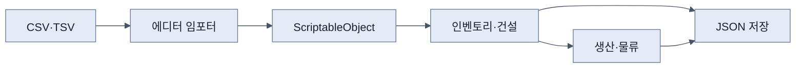
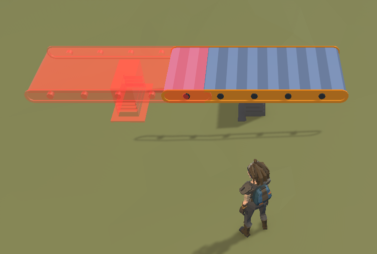
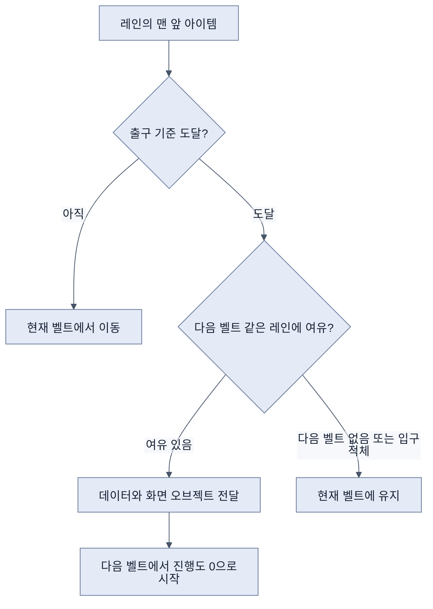
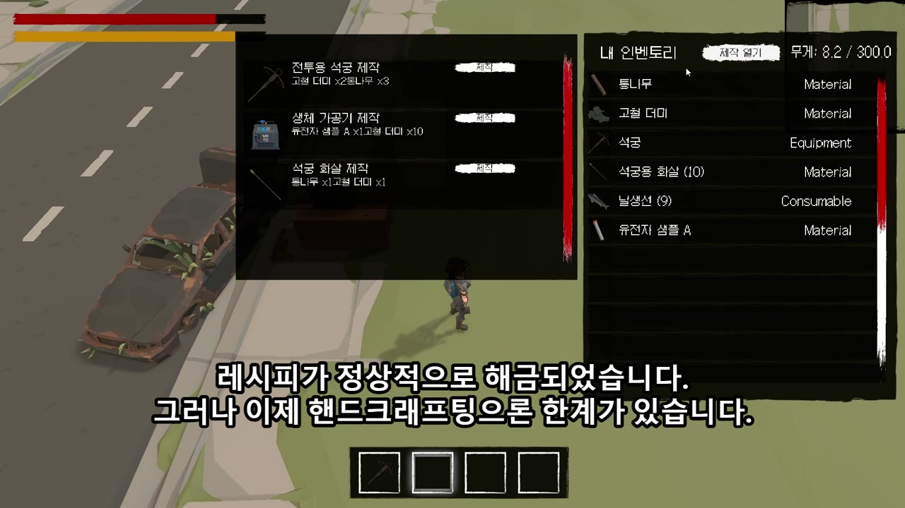
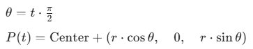
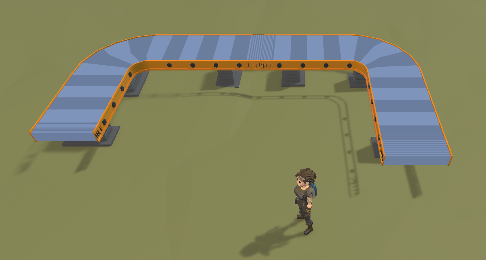

# Re-Genesis

> 자원을 모아 생산 시설을 짓고 물류를 자동화하는 3D 생존 게임

| 항목 | 내용 |
|---|---|
| 장르 | 3D 탑뷰 생존·공장 자동화 |
| 개발 기간 | 2026.01.20–02.07 · 약 3주 |
| 개발 인원 | 1인 개발 |
| 개발 환경 | Unity 6000.3.2f1, C#, Rider |
| 플랫폼 | Windows PC |
| 주요 기술 | CSV·TSV, ScriptableObject, 컨베이어 물류, JSON 저장, 이벤트 기반 UI |
| 담당 | 데이터 임포터, 인벤토리, 건설·물류·퀘스트 시스템 개발 |
| 링크 | [GitHub](https://github.com/Searabbit11/Re-Genesis) · [시연 영상](https://youtu.be/QIrySg5GNoQ) · [기술 문서 PDF](https://drive.google.com/file/d/1-p7w1uLVc3miBk87b66UoD4CX7bYHDRW/view) |


## 1. 개요

### 1.1 게임과 개발 목표

황폐화된 행성에서 자원을 모으고 생산 시설을 지어 제네시스 시스템을 복구하는 게임입니다. 자원을 채굴하고 필요한 물품을 제작하며, 컨베이어로 생산 시설을 연결해 퀘스트를 진행합니다.

직선과 곡선 벨트에서 같은 기준으로 아이템 간격과 전달 시점을 정할 수 있도록, 이동 판단과 화면 위치 계산을 나눴습니다.

아이템과 레시피를 표에서 관리하고 게임에 반영하는 에디터 도구를 만들었습니다. 건설한 시설, 인벤토리와 퀘스트 진행 상황은 저장한 뒤 불러올 수 있도록 구현했습니다.

### 1.2 플레이 흐름과 담당 범위

처음에는 탐색과 수집으로 재료를 모아 인벤토리에서 직접 제작합니다. 조력자 로그의 퀘스트 보상으로 레시피를 열면 채굴기와 가공기를 설치하고, 컨베이어로 시설을 연결해 생산을 반복할 수 있습니다. 생산한 물품은 다음 퀘스트와 제네시스 복구에 쓰입니다.

개인 프로젝트로 아이템·레시피 임포터, 인벤토리, 그리드 배치와 철거, 직선·곡선 컨베이어와 기계 입출력, 퀘스트·레시피 해금, 플레이 상태 저장을 구현했습니다.

## 2. 시스템 구조

### 2.1 데이터와 게임 시스템의 연결

CSV·TSV의 아이템·레시피·건설물 정보를 ScriptableObject 에셋으로 변환합니다. 인벤토리·건설·생산 시스템은 이 에셋을 사용하고, 플레이 중 바뀐 상태는 JSON으로 저장합니다.



| 구성요소 | 책임 |
|---|---|
| ItemCSVImporter 등 에디터 도구 | 표 데이터를 읽어 데이터 에셋 생성·갱신 |
| ItemData·RecipeData·BuildingData | 아이템·레시피·건설물 정의 |
| InventoryManager | 보유 아이템과 인벤토리 변경 처리 |
| BuildManager | 건설 프리뷰, 설치 가능 여부, 배치·철거 |
| ConveyorBelt | 아이템 진행도, 레인 간격, 곡선 위치, 다음 벨트 전송 |
| QuestManager | 목표 진행과 보상, 레시피 해금 연결 |

정의 데이터에는 아이템의 ID와 속성, 레시피의 재료와 결과물, 시설의 프리팹 같은 정보를 둡니다. 게임 도중에는 이 정의를 참조해 수량, 진행도, 슬롯처럼 변하는 값만 각 시스템이 관리합니다. 저장할 때는 개별 에셋과 프리팹을 ID로 식별하고, 다시 열 때 해당 ID의 정의를 찾아 상태를 복원합니다.

## 3. 핵심 기능

### 3.1 표 데이터의 ScriptableObject 변환

구글 시트에서 내보낸 CSV·TSV를 읽어 ScriptableObject 에셋을 생성하거나 갱신하는 에디터 도구입니다. 아이템 ID로 기존 에셋을 찾아 갱신하고, 해당 ID가 없으면 새로 만듭니다. 아이템 정보를 하나씩 입력하는 대신 표를 수정한 뒤 다시 가져오도록 했습니다.

레시피를 가져올 때는 재료와 결과물에 적힌 아이템 ID로 기존 `ItemData` 에셋을 찾아 연결합니다. 수량이나 제작 시간을 바꿀 때는 표를 수정하고 다시 가져옵니다. 같은 ID의 에셋을 다시 생성하지 않고 갱신하므로, 이미 연결된 에셋을 다시 지정할 필요가 없습니다.


아이템 ID로 에셋을 조회하고, 없는 경우에만 생성하는 코드입니다.

```csharp
// 에셋 생성 및 저장 로직
if (Directory.Exists(ITEM_DATA_PATH) == false)
{
    Directory.CreateDirectory(ITEM_DATA_PATH);
}

string assetFilePath = $"{ITEM_DATA_PATH}/Item_{itemID}.asset";
ItemData itemData = AssetDatabase.LoadAssetAtPath<ItemData>(assetFilePath);
if (itemData == null)
{
    itemData = ScriptableObject.CreateInstance<ItemData>();
    AssetDatabase.CreateAsset(itemData, assetFilePath);
}
```

#### 레시피가 참조하는 아이템을 연결하는 순서

1. `ItemCSVImporter`가 아이템 ID로 에셋 경로를 만들고, 기존 에셋이 있으면 그 객체의 값을 갱신합니다.
2. `RecipeCSVImporter`가 레시피의 재료와 결과물 ID를 읽고, 해당 `ItemData`를 찾아 레시피 에셋에 연결합니다.
3. 런타임에서 제작 UI와 생산 시설이 `RecipeData`를 참조해 제작 조건과 결과물을 결정합니다.

같은 ID를 유지하면 레시피나 프리팹에서 이미 참조하는 에셋을 다시 연결할 필요가 없습니다. 표에서 제작 수량이나 시간을 조정하고 같은 레시피를 다시 가져오는 작업에 이 방식을 사용했습니다.

### 3.2 그리드 건설과 배치 피드백

시설을 그리드에 맞춰 배치하고, 설치할 수 있는 위치인지 프리뷰 색상으로 보여줍니다. 바닥과 이미 설치한 오브젝트를 구분해 배치 가능 여부를 확인합니다. 철거하면 해당 시설 아이템을 인벤토리로 돌려줍니다.




#### 프리뷰에서 실제 설치까지

`BuildManager`가 마우스 화면 좌표에서 지면으로 Raycast를 쏘고, `GridManager`가 맞은 지점을 가장 가까운 그리드 좌표로 변환합니다. 프리뷰는 그 좌표에 붙고 90도씩 회전합니다. 벨트는 프리뷰에서 직선·좌회전·우회전을 바꿔 배치 전에 연결 방향을 확인할 수 있습니다.

`BuildPreview`는 트리거에 들어온 콜라이더 중 지면을 제외하고 겹침을 기록합니다. 설치 시에는 이 충돌 목록과 함께 `StructureManager`의 같은 칸, 같은 구조물 유형의 점유 여부를 확인합니다. 그리드 한 칸에 벨트용 `Floor`와 기계용 `Object`를 따로 기록해, 같은 위치에 벨트와 기계가 연결되는 배치를 표현했습니다.

`BuildManager.PlaceBuilding`에서 프리뷰의 벨트 모양을 설치물에 전달하는 분기입니다. 설치물은 이어서 구조물 지도에 등록합니다.

```csharp
ConveyorBelt previewBelt = currentPreview.GetComponent<ConveyorBelt>();
ConveyorBelt realBelt = newBuilding.GetComponent<ConveyorBelt>();
if (previewBelt != null && realBelt != null)
{
    realBelt.SetShape(previewBelt.currentShape);
}
```

#### 채굴·제작과 기계의 입출력

| 단계 | 처리 |
|---|---|
| 직접 제작 | `PlayerCraftingUI`가 `MachineType.None` 레시피를 표시하고, 재료가 충분하면 인벤토리에서 차감한 뒤 결과물을 추가합니다. |
| 광맥 채굴 | `ItemExtractor`가 주변의 `ResourceVein`을 찾아 채굴 주기마다 그 자원을 생산합니다. |
| 벨트에서 기계로 | `BaseMachine`은 벨트 진행도 0.4~0.6 구간에서 입력 슬롯에 넣을 수 있는 아이템을 가져옵니다. |
| 기계에서 벨트로 | 재료를 소비해 제작을 시작하고, 제작 시간이 끝나면 결과물을 출력 슬롯에 넣습니다. 공간이 생길 때까지 결과물 적재를 다시 시도하며, 벨트가 결과물을 받으면 기계 인벤토리에서 1개를 차감합니다. |

<figure>
  <video src="images/machine-output.mp4" poster="images/machine-output-poster.jpg" controls playsinline preload="none" aria-label="가공 결과물이 컨베이어로 나오는 시연" style="display:block;width:100%;height:auto"></video>
  <figcaption>기계가 제작한 결과물을 연결된 벨트로 출력하는 장면.</figcaption>
</figure>

### 3.3 진행도 기반 컨베이어 물류

벨트 위 아이템은 레인과 0~1 사이의 진행도로 관리합니다. 같은 레인에서는 앞 아이템의 진행도에서 설정한 간격을 빼 뒤 아이템이 갈 수 있는 한계를 정합니다. 맨 앞 아이템이 출구에 가까워지면 다음 벨트의 같은 레인에 여유가 있을 때 넘깁니다. 기계가 재료를 받지 못할 때는 아이템이 입력 지점을 넘지 않도록 진행도를 제한합니다.

직선에서는 진행도를 벨트 길이 방향의 좌표로 바꾸고, 곡선에서는 0~90도 사이의 각도로 바꿔 위치와 회전을 계산합니다. 레인별 반경과 중심점·출구 오프셋으로 벨트 모델에 경로를 맞췄습니다.

간격과 전달 조건을 진행도로 판단하면 벨트의 모양을 바꿔도 같은 이동 규칙을 쓸 수 있습니다.

| 비교 항목 | 직선 벨트 | 곡선 벨트 |
|---|---|---|
| 간격 판단 | 같은 레인의 앞 아이템 진행도를 기준으로 제한 | 직선과 같은 규칙 사용 |
| 다음 벨트로 전달 | 출구에 가까워지면 다음 레인 입구의 여유를 확인 | 직선과 같은 규칙 사용 |
| 화면에 그릴 위치 | 진행도를 길이 방향 좌표로 변환 | 진행도를 각도로 바꾸고 레인별 반경으로 원호 좌표를 계산 |


좌회전 벨트에서 아이템 위치를 계산하는 코드입니다.

```csharp
float radius = curveRadius + xOffset;
float angle = item.Progress * 90f * Mathf.Deg2Rad;

float cX = -0.5f + curveCenterOffset.x; // 회전 중심 X
// Inspector의 Vector2에서 y를 회전 중심 Z의 보정값으로 사용합니다.
float cZ = -0.5f + curveCenterOffset.y;

localPos = new Vector3(
    cX + radius * Mathf.Cos(angle),
    ItemHeight,
    cZ + radius * Mathf.Sin(angle));
localRot = Quaternion.Euler(0, -90f * item.Progress, 0);
```

#### 한 레인 안에서 간격 유지

`ConveyorBelt.MoveItems`는 좌우 레인을 각각 처리합니다. 뒤 아이템은 앞 아이템의 진행도에서 `itemSpacing`을 뺀 값까지만 이동합니다. 기계가 입력을 받을 수 없고 아이템이 입력점 앞에 있으면 상한을 중앙으로 당깁니다. 그 아이템이 멈추면 뒤 아이템도 같은 간격 규칙 때문에 차례로 대기합니다.

아래는 `MoveItems`의 이동 부분입니다. 앞에서 정한 상한을 사용해 프레임 사이 이동량을 제한합니다.

```csharp
if (item.Progress < nextPositionLimit)
{
    item.Progress += speed * Time.deltaTime;
    if (item.Progress > nextPositionLimit)
    {
        item.Progress = nextPositionLimit;
    }
}
```

#### 곡선 좌표와 월드 좌표

진행도 0, 0.5, 1은 곡선의 0도, 45도, 90도에 대응합니다. Sin·Cos로 구한 원호 좌표에 모델별 중심점 보정값을 더하고, 좌우 레인의 반경을 다르게 적용합니다. 마지막에 `TransformPoint`로 로컬 위치를 월드 위치로 바꿉니다. 아이템 회전에는 벨트 자체의 회전과 곡선을 돌면서 변한 로컬 회전을 함께 적용합니다.

#### 다음 벨트로 전달

`FindNextBelt`는 현재 벨트의 방향과 길이로 기본 출구 칸을 계산합니다. 수동 출구 오프셋이 설정된 곡선은 그 값을 벨트 회전에 맞게 돌린 뒤 시작 칸에 더합니다. 이 좌표로 구조물 지도에서 이웃 벨트를 조회합니다.

맨 앞 아이템이 출구 기준에 도달하면 다음 벨트 같은 레인의 입구를 확인합니다. 입구에 여유가 있으면 아이템 데이터와 화면 오브젝트를 함께 넘깁니다. 다음 벨트는 진행도를 0으로 시작하고, 이전 벨트는 전달이 성공한 뒤에 목록에서 해당 아이템을 제거합니다.



<figure>
  <video src="images/conveyor-placement.mp4" poster="images/conveyor-placement-poster.jpg" controls playsinline preload="none" aria-label="곡선 벨트 배치 시연" style="display:block;width:100%;height:auto"></video>
  <figcaption>직선과 곡선 벨트를 이어 설치하며 출구 방향을 맞추는 장면.</figcaption>
</figure>

### 3.4 플레이 상태 저장과 이벤트 연동

플레이어 위치와 상태, 인벤토리 슬롯, 건축물의 좌표와 설정, 퀘스트 진행 및 해금 정보를 JSON으로 저장합니다.

#### 저장 항목과 복원 방식

| 대상 | 저장하는 값 | 복원 처리 |
|---|---|---|
| 플레이어 | 위치, 회전, 체력, 허기 | 위치를 적용하는 동안 `CharacterController`를 잠시 끄고, 체력과 허기를 다시 설정합니다. |
| 인벤토리 | 아이템 ID, 수량, 슬롯 인덱스 | ID로 `ItemData`를 찾고, 저장된 인덱스에 수량을 넣은 뒤 인벤토리 변경을 알립니다. |
| 건축물 | 건물 ID, 위치, Y축 회전, 벨트 모양, 시설 내부 아이템 | 건물 ID로 프리팹을 생성하고 회전·벨트 모양·슬롯을 적용한 뒤 그리드에 다시 등록합니다. |
| 퀘스트·레시피 | 완료한 퀘스트 ID, 보상 대기 중인 퀘스트 ID, 열린 레시피 ID | 각 매니저가 저장된 ID 목록으로 현재 진행과 해금 상태를 복원합니다. |

`StructureManager.SaveGame`이 값을 하나의 `SaveDataWrapper`에 모아 `JsonUtility`로 직렬화합니다. 기존 저장 파일이 있으면, `LoadGame`은 그 파일을 읽어 배치된 구조물을 정리한 뒤 저장된 건물부터 다시 만듭니다. 이후 플레이어, 인벤토리, 퀘스트, 레시피 순으로 데이터를 적용합니다.


<figure>
  <video src="images/save-restore.mp4" poster="images/save-restore-poster.jpg" controls playsinline preload="none" aria-label="곡선 컨베이어 배치 저장과 이어하기 시연" style="display:block;width:100%;height:auto"></video>
  <figcaption>곡선 벨트 배치를 저장하고 이어하기에서 같은 구조물을 다시 확인하는 장면.</figcaption>
</figure>

### 3.5 인벤토리·UI·퀘스트

인벤토리 변경과 획득 이벤트를 나눴습니다. `InventoryUI`는 `OnInventoryUpdated`를 받아 화면을 갱신합니다. `QuestManager`는 아이템 ID를 담은 `OnItemObtained`를 받아, 해당 `OnGet_{itemID}` 트리거가 있는 미완료 퀘스트를 찾습니다. 생산 시설도 결과물을 만들었을 때 같은 획득 알림을 보냅니다. 건설 완료에는 별도의 `OnBuildingPlaced` 이벤트가 있습니다.

`QuestManager.Start`에서 인벤토리 이벤트를 구독하는 부분입니다.

```csharp
if (InventoryManager.Instance != null)
{
    InventoryManager.Instance.OnItemObtained += (itemID) => CheckTrigger($"OnGet_{itemID}");
}
```

조건을 만족한 퀘스트는 완료 목록과 보상 대기 목록에 넣습니다. 라디오 메시지를 보내고, `RogueRadio`는 메시지 이벤트를 받아 말풍선을 띄웁니다. 플레이어가 보상을 수령할 때 `ClaimReward`가 설정된 레시피를 열고 대기 목록에서 퀘스트를 제거합니다. 완료와 보상 수령 상태를 따로 저장하기 때문에, 보상 수령 전에 게임을 저장한 경우에도 이어하기에서 대기 상태를 복원할 수 있습니다.



### 3.6 생존과 적 행동

`PlayerStats`는 플레이 중 허기를 줄이고, 허기가 0이 되면 일정 간격으로 체력을 감소시킵니다. `PlayerController`는 소지 무게 비율이 80%를 넘으면 이동 속도를 낮추고, 120%를 넘은 상태로 이동하면 체력 감소를 적용합니다.

`SimpleEnemyAI`는 대기, 추적, 공격, 사망 상태를 나눠 처리합니다. 추적 중 이동에는 `NavMeshAgent`를 사용하고, 에이전트의 자동 회전을 끈 뒤 추적과 공격 상태에 다른 회전 속도를 적용합니다.

## 4. 문제 해결

### 4.1 곡선 벨트에서 아이템이 가로지르는 문제

**문제:** 곡선 구간에 직선 보간을 적용하자 아이템이 원호를 따라가지 않고 안쪽을 가로질렀습니다.

**원인:** 시작점과 끝점 사이를 직선으로 보간해 곡선 벨트의 형태를 반영하지 못했습니다.

**해결:** 진행도를 0~90도의 각도로 바꿔 Sin·Cos로 원호 위의 위치를 계산했습니다. 레인별 반경과 중심점 오프셋을 조절해 벨트 모델에 경로를 맞췄습니다.



**결과:** 아이템 이동 경로를 직선에서 벨트 형태에 맞는 원호로 바꿨습니다.

직선 보간은 시작점과 끝점을 잇는 현 위의 점을 계산합니다. 곡선에서는 같은 진행도를 각도로 바꾼 다음 반경을 적용하면 원호 위에 점을 놓을 수 있습니다. 이때 수정 범위를 위치와 회전 계산에 두어, 아이템 간격과 다음 벨트로의 전달 조건은 기존 이동 계산에 남겼습니다.

### 4.2 벨트 연결부의 위치 단절과 전송 타이밍

**문제:** 모델의 피벗과 길이 차이로 연결부에서 아이템이 뜨거나, 다음 벨트로 넘어갈 때 잠깐 끊겨 보였습니다.



**해결:** 중심점과 출구 오프셋으로 위치를 보정했습니다. 진행도가 BeltEndThreshold에 도달하면 다음 벨트가 아이템을 받을 수 있는지 확인한 뒤 넘기도록 했습니다.

**결과:** 연결부 위치와 다음 벨트로 넘기는 시점을 모델에 맞게 조정했습니다.

원호의 중심과 다음 벨트를 찾는 좌표는 서로 다른 문제였습니다. `curveCenterOffset`은 아이템이 모델 위에 그려지는 경로를 보정하고, `customExitOffset`은 그리드에서 연결할 벨트의 칸을 지정합니다. 2026.01.30 커밋 `0a0e27f0`에서 반경·중심점 설정과 수동 출구 오프셋을 추가한 변경을 확인할 수 있습니다.

## 5. 결과

### 5.1 구현 결과

- 표를 수정해 아이템·레시피 데이터를 갱신하는 에디터 도구를 만들었습니다.
- 시설 배치부터 컨베이어 운송, 생산, 퀘스트 진행까지 구현했습니다.
- 플레이어·인벤토리·건축물·퀘스트 상태를 JSON으로 저장하고 불러오도록 했습니다.

### 5.2 배운 점

아이템을 옮기는 규칙과 화면에 보이는 위치를 나눠 두니, 벨트의 모양이 바뀌어도 간격과 전달 조건을 다시 만들 필요가 없었습니다. 연결부 문제를 해결하면서 한 구간에서 자연스럽게 움직이는지와 여러 구간을 이어 놓았을 때 데이터가 제대로 넘어가는지를 함께 확인해야 한다는 점을 배웠습니다.

### 5.3 회고

처음에는 파밍 구역과 거점이 뚜렷이 나뉘는 월드맵을 구상했습니다. 개발 기간에는 채굴·제작·운송이 이어지는 흐름을 완성하는 데 집중했습니다. 프로젝트를 확장한다면 파밍 구역에서 자원을 모아 거점으로 가져오는 동선부터 설계하고 싶습니다.

UI에서는 인벤토리와 제작 창을 함께 열었을 때 필요한 정보가 잘 보이는지부터 살펴보고 싶습니다. 플레이어가 창 위치를 직접 옮길 수 있게 만들어, 두 창을 함께 쓸 때 원하는 위치에 정보를 놓을 수 있도록 개선하고 싶습니다.
