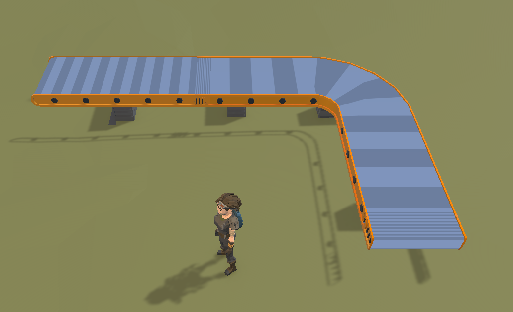
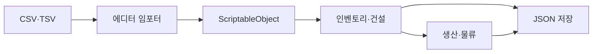
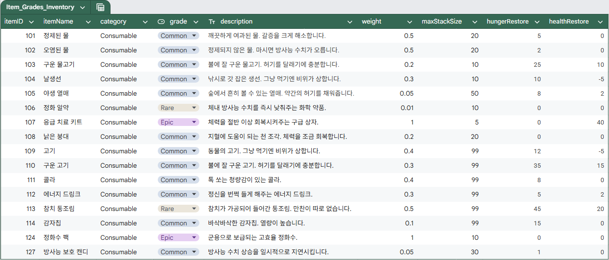
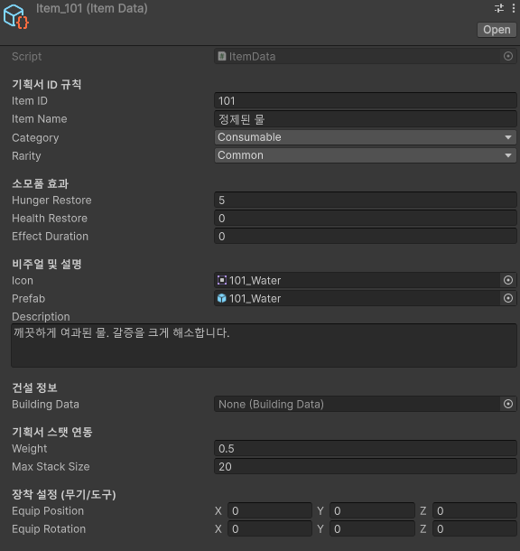
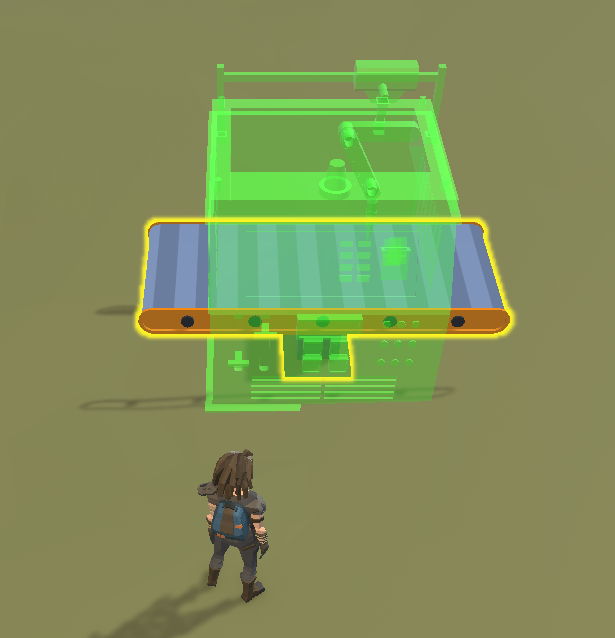

# Re-Genesis

> 자원을 모아 생산 시설을 짓고 물류를 자동화하는 3D 생존 게임

| 항목 | 내용 |
|---|---|
| 장르 | 3D 탑뷰 생존·공장 자동화 |
| 개발 기간 | 2026.01.20 ~ 2026.02.07 |
| 개발 인원 | 1인 개발 |
| 개발 환경 | Unity 6000.3.2f1, C#, Rider |
| 플랫폼 | Windows PC |
| 주요 기술 | CSV·TSV, ScriptableObject, 컨베이어 물류, JSON 저장, 이벤트 기반 UI |
| 담당 | 데이터 임포터, 인벤토리, 건설·물류·퀘스트 시스템 개발 |
| 링크 | [GitHub](https://github.com/Searabbit11/Re-Genesis) · [시연 영상](https://youtu.be/QIrySg5GNoQ) |



## 1. 개요

### 1.1 게임과 개발 목표

황폐화된 행성에서 자원을 모으고 생산 시설을 지어 제네시스 시스템을 복구하는 게임입니다. 자원을 채굴하고 필요한 물품을 제작하며, 컨베이어로 생산 시설을 연결해 퀘스트를 진행합니다.

직선과 곡선 벨트에서 같은 기준으로 아이템 간격과 전달 시점을 정할 수 있도록, 이동 판단과 화면 위치 계산을 나눴습니다.

아이템과 레시피를 표에서 관리하고 게임에 반영하는 에디터 도구를 만들었습니다. 건설한 시설, 인벤토리와 퀘스트 진행 상황은 저장한 뒤 불러올 수 있도록 구현했습니다.

## 2. 시스템 구조

### 2.1 데이터와 게임 시스템의 연결

CSV·TSV의 아이템·레시피·건설물 정보를 ScriptableObject 에셋으로 변환합니다. 인벤토리·건설·생산 시스템은 이 에셋을 사용하고, 플레이 중 바뀐 상태는 JSON으로 저장합니다.



| 구성요소 | 책임 |
|---|---|
| ItemCSVImporter 등 에디터 도구 | 표 데이터를 읽어 데이터 에셋 생성·갱신 |
| ItemData·RecipeData·BuildingData | 아이템·레시피·건설물 정의 |
| InventoryManager | 보유 아이템과 인벤토리 변경 처리 |
| BuildManager | 건설 프리뷰, 설치 가능 여부, 배치·철거 |
| ConveyorBelt | 아이템 진행도, 레인 간격, 곡선 위치, 다음 벨트 전송 |
| QuestManager | 목표 진행과 보상, 레시피 해금 연결 |

## 3. 핵심 기능

### 3.1 표 데이터의 ScriptableObject 변환

구글 시트에서 내보낸 CSV·TSV를 읽어 ScriptableObject 에셋을 생성하거나 갱신하는 에디터 도구입니다. 아이템 ID로 기존 에셋을 찾아 갱신하고, 해당 ID가 없으면 새로 만듭니다. 아이템 정보를 하나씩 입력하는 대신 표를 수정한 뒤 다시 가져오도록 했습니다.

레시피를 가져올 때는 재료와 결과물에 적힌 아이템 ID로 기존 `ItemData` 에셋을 찾아 연결합니다. 수량이나 제작 시간을 바꿀 때는 표를 수정하고 다시 가져옵니다. 같은 ID의 에셋을 다시 생성하지 않고 갱신하므로, 이미 연결된 에셋을 다시 지정할 필요가 없습니다.





아이템 ID로 에셋을 조회하고, 없는 경우에만 생성하는 코드입니다.

```csharp
                // 에셋 생성 및 저장 로직
                if (Directory.Exists(ITEM_DATA_PATH) == false) Directory.CreateDirectory(ITEM_DATA_PATH);
                string assetFilePath = $"{ITEM_DATA_PATH}/Item_{itemID}.asset";

                ItemData itemData = AssetDatabase.LoadAssetAtPath<ItemData>(assetFilePath);
                if (itemData == null)
                {
                    itemData = ScriptableObject.CreateInstance<ItemData>();
                    AssetDatabase.CreateAsset(itemData, assetFilePath);
                }
```

### 3.2 그리드 건설과 배치 피드백

시설을 그리드에 맞춰 배치하고, 설치할 수 있는 위치인지 프리뷰 색상으로 보여줍니다. 바닥과 이미 설치한 오브젝트를 구분해 배치 가능 여부를 확인합니다. 철거할 때는 사용한 재료를 돌려줍니다.




### 3.3 진행도 기반 컨베이어 물류

벨트 위 아이템은 레인과 0~1 사이의 진행도로 관리합니다. 같은 레인에서는 앞 아이템의 진행도에서 설정한 간격을 빼 뒤 아이템이 갈 수 있는 한계를 정합니다. 맨 앞 아이템이 출구에 가까워지면 다음 벨트의 같은 레인에 여유가 있을 때 넘깁니다. 기계가 재료를 받지 못할 때는 아이템이 입력 지점을 넘지 않도록 진행도를 제한합니다.

직선에서는 진행도를 벨트 길이 방향의 좌표로 바꾸고, 곡선에서는 0~90도 사이의 각도로 바꿔 위치와 회전을 계산합니다. 레인별 반경과 중심점·출구 오프셋으로 벨트 모델에 경로를 맞췄습니다.

간격과 전달 조건을 진행도로 판단하면 벨트의 모양을 바꿔도 같은 이동 규칙을 쓸 수 있습니다.

| 비교 항목 | 직선 벨트 | 곡선 벨트 |
|---|---|---|
| 간격 판단 | 같은 레인의 앞 아이템 진행도를 기준으로 제한 | 직선과 같은 규칙 사용 |
| 다음 벨트로 전달 | 출구에 가까워지면 다음 레인 입구의 여유를 확인 | 직선과 같은 규칙 사용 |
| 화면에 그릴 위치 | 진행도를 길이 방향 좌표로 변환 | 진행도를 각도로 바꾸고 레인별 반경으로 원호 좌표를 계산 |


좌회전 벨트에서 아이템 위치를 계산하는 코드입니다.

```csharp
            float radius = curveRadius + xOffset; 
            float angle = item.Progress * 90f * Mathf.Deg2Rad;

            float cX = -0.5f + curveCenterOffset.x; // 회전 중심 X
            float cZ = -0.5f + curveCenterOffset.y; // 회전 중심 Z (Inspector는 Vector2라 y를 z로 사용)

            localPos = new Vector3(cX + radius * Mathf.Cos(angle), ItemHeight, cZ + radius * Mathf.Sin(angle));
            localRot = Quaternion.Euler(0, -90f * item.Progress, 0);
```

### 3.4 플레이 상태 저장과 이벤트 연동

플레이어 위치와 상태, 인벤토리 슬롯, 건축물의 좌표와 설정, 퀘스트 진행 및 해금 정보를 JSON으로 저장합니다. 아이템을 얻거나 건물을 배치하면 이벤트로 UI와 퀘스트에 변경 사항을 알립니다.

## 4. 문제 해결

### 4.1 곡선 벨트에서 아이템이 가로지르는 문제

**문제:** 곡선 구간에 직선 보간을 적용하자 아이템이 원호를 따라가지 않고 안쪽을 가로질렀습니다.

**원인:** 시작점과 끝점 사이를 직선으로 보간해 곡선 벨트의 형태를 반영하지 못했습니다.

**해결:** 진행도를 0~90도의 각도로 바꿔 Sin·Cos로 원호 위의 위치를 계산했습니다. 레인별 반경과 중심점 오프셋을 조절해 벨트 모델에 경로를 맞췄습니다.

**결과:** 아이템 이동 경로를 직선에서 벨트 형태에 맞는 원호로 바꿨습니다.

### 4.2 벨트 연결부의 위치 단절과 전송 타이밍

**문제:** 모델의 피벗과 길이 차이로 연결부에서 아이템이 뜨거나, 다음 벨트로 넘어갈 때 잠깐 끊겨 보였습니다.

**해결:** 중심점과 출구 오프셋으로 위치를 보정했습니다. 진행도가 BeltEndThreshold에 도달하면 다음 벨트가 아이템을 받을 수 있는지 확인한 뒤 넘기도록 했습니다.

**결과:** 연결부 위치와 다음 벨트로 넘기는 시점을 모델에 맞게 조정했습니다.

## 5. 결과

### 5.1 구현 결과

- 표를 수정해 아이템·레시피 데이터를 갱신하는 에디터 도구를 만들었습니다.
- 시설 배치부터 컨베이어 운송, 생산, 퀘스트 진행까지 구현했습니다.
- 플레이어·인벤토리·건축물·퀘스트 상태를 JSON으로 저장하고 불러오도록 했습니다.
