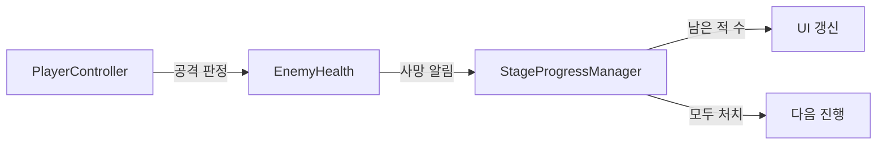

# Attack-Roguelike

> 빠른 이동과 콤보 전투로 적을 처치하는 2D 액션 플랫포머

| 항목 | 내용 |
|---|---|
| 장르 | 2D 액션 플랫포머 로그라이크 |
| 개발 기간 | 2025.12 · 10일 |
| 개발 인원 | 1인 개발 |
| 개발 환경 | Unity 6000.3.2f1, C#, Rider |
| 플랫폼 | Windows PC |
| 주요 기술 | RaycastHit2D, FSM, Animation Event, C# 이벤트, Hit Stop |
| 담당 | 이동·충돌, 콤보 전투, 적 AI, 피격 효과와 스테이지 진행 개발 |
| 링크 | [GitHub](https://github.com/Searabbit11/Attack-Roguelike) · [시연 영상](https://youtu.be/AbxDOZJ2oMo) · [기술 문서 PDF](https://drive.google.com/file/d/1uOeQDZVlekgcs0ZOFPyRr3V3xwOPDlws/view) |


## 1. 개요

### 1.1 게임과 개발 목표

Skul에서 영감을 받은 2D 액션 플랫포머입니다. 스테이지의 적을 모두 처치하면 다음 단계가 열리고, Day가 지날수록 적이 강해집니다.

이동·점프·대시와 콤보 공격의 조작감을 조정하는 데 집중했습니다. 이동 속도와 충돌 거리를 직접 제어하도록 Raycast 기반 이동을 구현하고, 적의 행동·피격·스테이지 진행은 각각 나눠 처리했습니다.

## 2. 시스템 구조

### 2.1 전투와 진행의 연결

공격으로 적이 사망하면 StageProgressManager가 남은 적 수를 갱신합니다. UI에는 변경된 적 수를 알리고, 모두 처치했을 때 클리어 이벤트를 보냅니다.



| 구성요소 | 책임 |
|---|---|
| PlayerController | 입력, 이동·점프·대시, 공격 판정과 Animator 연동 |
| PlayerHealth | 플레이어 체력·피격·사망 |
| EnemyController | 코루틴 기반 적 상태 처리 |
| EnemyHealth | 적 체력·넉백·피격 머티리얼·사망 알림 |
| StageProgressManager | 남은 적 집계와 진행 이벤트 |
| HitStopManager | 타격 시 짧은 시간 정지 연출 |

## 3. 핵심 기능

### 3.1 Raycast 기반 이동과 충돌

이동량과 중력을 계산한 뒤, 이동 방향으로 Raycast를 쏴 충돌면까지의 거리 안에서 움직이게 했습니다. 벽과 캐릭터 사이에는 wallSkin만큼 간격을 두어 부동소수점 오차로 벽 안에 파고드는 문제를 보정했습니다.


벽에 붙었을 때 위치를 보정하고 이동 거리를 제한하는 코드입니다.

```csharp
            if (distToWall <= wallSkin)
            {
                // 살짝 반대 방향으로 빼줘서 '낑김' 상태 완화
                transform.position += new Vector3(-dir * wallSkin, 0f, 0f);
                return 0f; // 이번 프레임은 더 이동하지 않음
            }

            // 2) 아직 여유가 있다면, 벽 앞에서 딱 멈추게
            float allowed = distToWall - wallSkin;
            if (allowed < 0f) allowed = 0f;

            return Mathf.Min(allowed, distance) * dir;
```

### 3.2 콤보·대시와 타격 피드백

콤보 공격의 타격 시점은 Animation Event로 처리하고, 대시에는 쿨타임과 무적 시간을 적용했습니다. 공격이 적중하면 Hit Stop, 피격 셰이더와 넉백으로 타격 반응을 보여줍니다.


### 3.3 적 FSM과 스테이지 진행

적은 플레이어와의 거리와 공격 범위에 따라 대기·순찰·추적·공격 상태를 오갑니다. 각 상태는 코루틴으로 실행하며, 사망하면 StageProgressManager에 알려 남은 적 수를 줄입니다.


```csharp
    public void OnEnemyDead()
    {
        if (RemainingEnemies <= 0) return;

        RemainingEnemies--;
        OnRemainingChanged?.Invoke(RemainingEnemies);

        if (RemainingEnemies == 0)
            OnStageCleared?.Invoke();
    }
```

## 4. 문제 해결

### 4.1 벽면 끼임과 떨림

**문제:** 벽에 밀착할 때 캐릭터가 미세하게 파고들거나 중력 처리와 겹쳐 떨리는 현상이 발생했습니다.

**원인:** 충돌면까지의 거리를 그대로 이동량으로 사용해 벽과 맞닿는 경계에서 수치 오차가 발생했습니다.

**해결:** 이동 거리를 충돌면까지의 거리에서 wallSkin을 뺀 값으로 제한했습니다. 이미 벽에 너무 가까우면 반대 방향으로 위치를 보정했습니다.

**결과:** 플레이어와 적이 벽과 작은 간격을 유지하도록 충돌 처리를 수정했습니다.

### 4.2 한 적의 피격 효과가 모든 적에게 적용되는 문제

**문제:** 적 하나를 타격했을 때 다른 적들도 함께 하얗게 표시됐습니다.

**원인:** 같은 머티리얼을 공유하는 상태에서 피격 셰이더의 프로퍼티를 변경했습니다.

**해결:** EnemyHealth를 초기화할 때 sharedMaterial을 복제해 각 적의 SpriteRenderer에 할당했습니다.

```csharp
        if (spriteRenderer != null)
        {
            // sharedMaterial을 건드리면 모든 적이 같이 변하니까, 복제본을 만들어 붙임
            instanceMaterial = Instantiate(spriteRenderer.sharedMaterial);
            spriteRenderer.material = instanceMaterial;

            // 시작값 0으로 보정
            instanceMaterial.SetFloat(HitEffectBlend, 0f);
        }
```

**결과:** 공유 머티리얼 대신 적마다 별도의 머티리얼에서 피격 효과를 처리하도록 바꿨습니다.

## 5. 결과

### 5.1 구현 결과

- 이동·점프·대시와 콤보 공격, Hit Stop·넉백을 구현했습니다.
- 벽면 충돌을 보정하고, 피격 효과가 다른 적에게 번지던 머티리얼 문제를 수정했습니다.
- 적의 사망에 따라 남은 적 수와 UI를 갱신하고 다음 스테이지를 열도록 했습니다.
