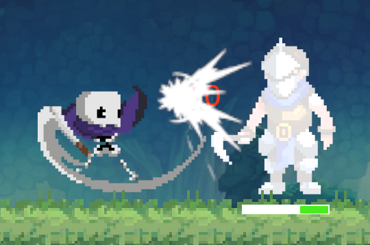
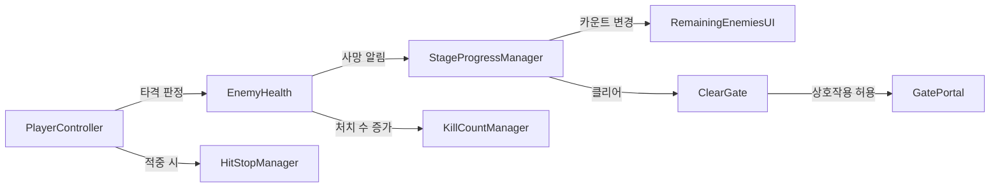
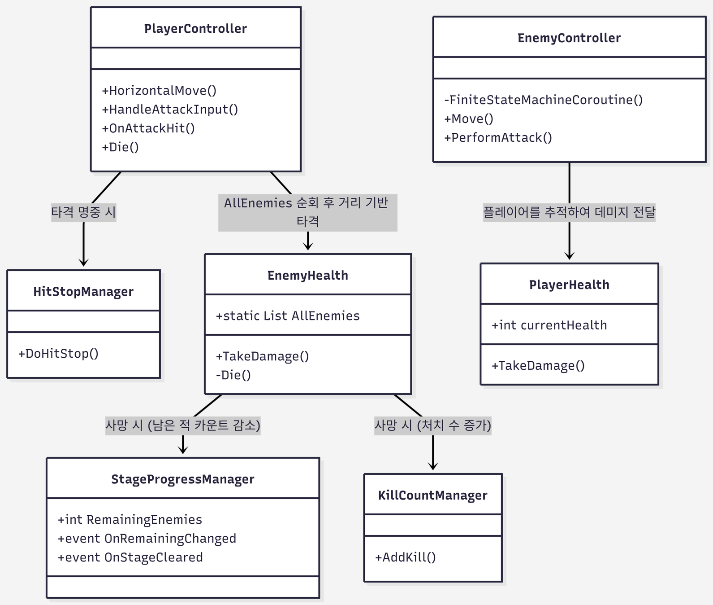
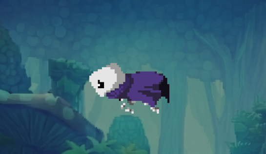
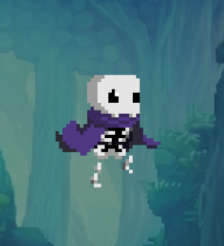
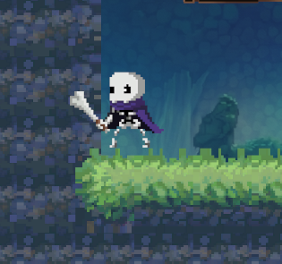
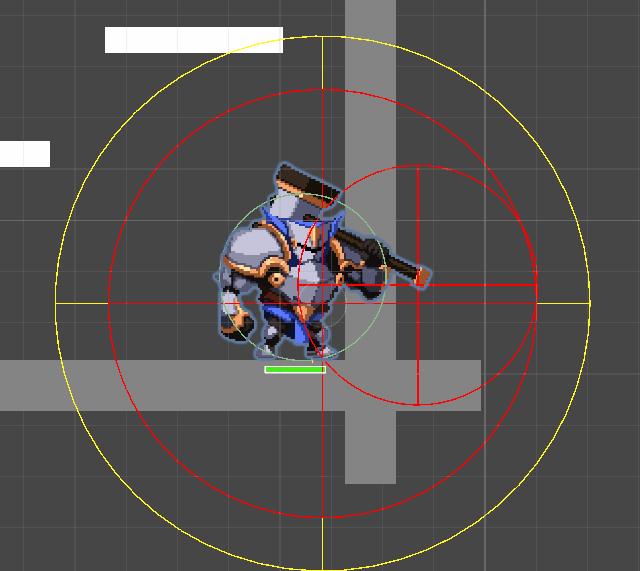
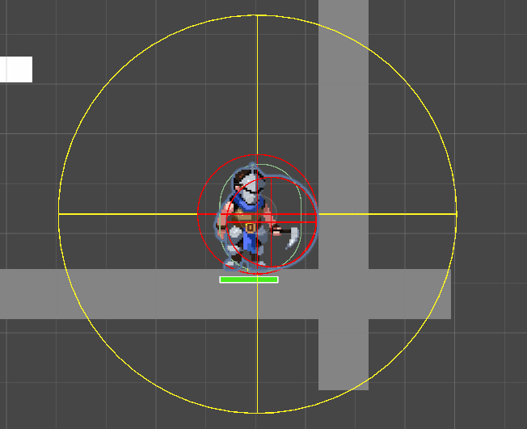
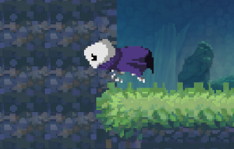
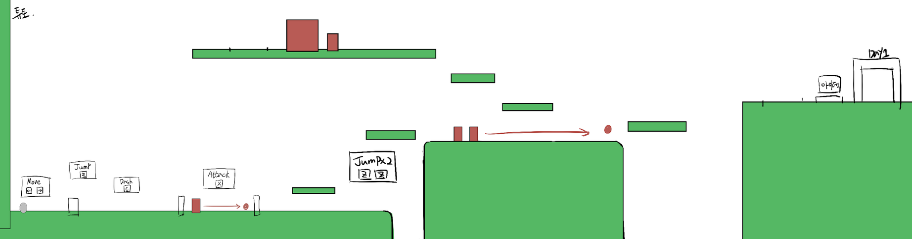

# Attack-Roguelike

> 점프와 대시로 공격을 피하고, 지상 콤보와 공중 공격으로 스테이지를 돌파하는 2D 액션 플랫포머

| 항목 | 내용 |
|---|---|
| 장르 | 2D 액션 플랫포머 로그라이크 |
| 개발 기간 | 2025.12 · 10일 |
| 개발 인원 | 1인 개발 |
| 개발 환경 | Unity 6000.3.2f1, C#, Rider |
| 플랫폼 | Windows PC |
| 주요 기술 | Physics2D.Raycast, Animation Event, 코루틴 FSM, C# 이벤트, Hit Stop, Tilemap |
| 구현 | 이동·충돌, 2단 점프·대시, 지상 콤보·공중 공격, 피격 연출, 적 AI, 스테이지 진행과 재도전 |
| 링크 | [GitHub](https://github.com/Searabbit11/Attack-Roguelike) · [시연 영상](https://youtu.be/AbxDOZJ2oMo) · [기술 문서 PDF](https://drive.google.com/file/d/1uOeQDZVlekgcs0ZOFPyRr3V3xwOPDlws/view) |



## 1. 개요

### 1.1 게임과 개발 목표

Skul에서 영감을 받은 2D 액션 플랫포머입니다. 빠른 전투와 반복 플레이를 중심으로, 이동 중에 적의 공격 범위를 읽고 점프·대시·공격 중 다음 행동을 고르게 했습니다. Day가 지날수록 더 까다로운 적 배치와 공격 패턴을 만나고, 재도전하면서 플레이어가 조작과 대응 타이밍을 익히는 흐름을 기획했습니다.

개발에서는 이동 거리와 충돌 위치를 직접 제어하는 데 집중했습니다. 공격 입력에는 지상 1·2타와 공중 공격을 연결하고, 공격 애니메이션의 타격 프레임에 맞춰 판정과 피격 연출을 실행했습니다.

### 1.2 플레이 흐름과 완성 범위

타이틀에서 시작하면 튜토리얼에 진입합니다. 각 전투 구역의 적을 모두 처치하면 문을 사용할 수 있고, 문 앞에서 위 방향키를 누르면 다음 씬으로 이동합니다. 사망 화면에서는 처치 수를 확인하고 현재 씬을 다시 시작하거나 타이틀로 돌아갈 수 있습니다.

| 구분 | 진행 방식 |
|---|---|
| 기획 | Day가 진행되면서 난이도가 올라가고, 세 번째 밤에 반복 여부를 선택하는 흐름을 구상했습니다. |
| Git의 씬 연결 | 타이틀 → 튜토리얼 → Day 1 → Day 2 → 엔딩으로 연결됩니다. Day 3은 빌드 목록에 있으나 Day 2의 문은 엔딩을 가리킵니다. |
| 엔딩 선택 | Day 1부터 다시 시작하거나, 타이틀로 돌아가거나, 게임을 종료할 수 있습니다. |

## 2. 시스템 구조

### 2.1 전투와 진행의 연결

공격으로 적이 사망하면 StageProgressManager가 남은 적 수를 갱신합니다. UI에는 변경된 적 수를 알리고, 모두 처치했을 때 클리어 이벤트를 보냅니다.



| 구성요소 | 책임 |
|---|---|
| `PlayerController` | 이동·점프·대시 입력, 직접 계산한 이동과 충돌 보정, 공격 상태와 타격 판정 |
| `PlayerHealth` | 피해량과 체력 관리, 체력이 0이면 컨트롤러에 사망 처리 요청 |
| `PlayerAnimationEvents` · `DeathAnimationBridge` | 공격 판정·공격 종료와 사망 연출 종료를 컨트롤러에 전달 |
| `EnemyController` · `EnemyAttackMelee` | 거리 기반 행동 상태, 공격 애니메이션과 근접 타격 판정 |
| `EnemyHealth` | 활성 적 등록, 체력·넉백·피격 머티리얼·체력 바와 데미지 숫자, 사망 알림 |
| `HitStopManager` | 씬 전환 후에도 유지되는 싱글톤으로 타격 순간의 시간 배율과 복원 관리 |
| `StageProgressManager` · `RemainingEnemiesUI` | 초기 적 집계, 카운트 변경과 클리어 이벤트 발행, 남은 적 문구 갱신 |
| `ClearGate` · `GatePortal` | 클리어 전 문 잠금, 클리어 후 상호작용과 씬 전환 |
| `KillCountManager` · `DeathUIController` | 처치 수 집계, 사망 화면과 재시작·타이틀 복귀 |



### 2.2 이벤트로 연결한 지점

Animation Event에는 공격이 맞아야 하는 프레임과 동작이 끝나는 프레임을 연결했습니다. 스테이지에서는 `Action<int>`과 `Action`으로 적 수 변경과 클리어를 알립니다. 남은 적 UI는 적 오브젝트를 직접 조회할 필요가 없고, 문은 클리어 이벤트만 받아 활성화합니다.

## 3. 핵심 기능

### 3.1 Raycast 기반 이동과 충돌

이동량과 중력을 계산한 뒤, 이동 방향으로 Raycast를 쏴 충돌면까지의 거리 안에서 움직이게 했습니다. Rigidbody2D에 이동을 맡겼던 초기 버전에서는 플랫포머에 맞는 빠른 정지와 착지 감각을 조정하기 어려웠습니다. 이동량과 위치 보정을 직접 계산하는 방식으로 전환했습니다.





벽과 캐릭터 사이에는 wallSkin만큼 간격을 두어 부동소수점 오차로 벽 안에 파고드는 문제를 보정했습니다. 아래는 `PlayerController.CheckWall`의 충돌 처리 부분입니다.

```csharp
if (distToWall <= wallSkin)
{
    // 살짝 반대 방향으로 빼줘서 '낑김' 상태 완화
    transform.position += new Vector3(-dir * wallSkin, 0f, 0f);
    return 0f; // 이번 프레임은 더 이동하지 않음
}

// 2) 아직 여유가 있다면, 벽 앞에서 딱 멈추게
float allowed = distToWall - wallSkin;
if (allowed < 0f) allowed = 0f;

return Mathf.Min(allowed, distance) * dir;
```

#### 이동량과 착지 판정

| 처리 | 구현 |
|---|---|
| 수평 이동 | 이동 입력 × 속도 × `Time.deltaTime`으로 이동량을 구합니다. 캐릭터 중심에서 좌우로 `이동 거리 + wallSkin`만큼 Raycast를 쏴 벽 레이어와의 충돌을 확인합니다. |
| 점프와 중력 | `Z` 입력으로 점프 속도를 적용합니다. 공중에서 중력으로 수직 속도를 줄이고, 낙하 속도에 하한을 둡니다. 기본 점프 횟수는 2회입니다. |
| 지면 확인 | 내려오는 동안 발 위치에서 아래로 Raycast를 쏩니다. 표면 법선의 Y값이 0.7 이상인 충돌을 지면으로 보고 이동량을 보정합니다. 착지하면 수직 속도와 점프 횟수를 초기화합니다. |
| 대시 | `C` 입력으로 현재 보는 방향을 고정하고 대시 전용 속도로 이동합니다. 일반 이동과 같은 벽 검사를 사용하며 대시 중에는 수평 위치만 적용합니다. |



### 3.2 콤보·대시와 타격 피드백

`X`의 첫 입력은 지상 1타를 시작합니다. 1타 중에 `comboMaxDelay` 안으로 한 번 더 입력하면 2타로 이어지고, 공중에서는 별도의 `JumpAttack`을 실행합니다. 애니메이션 종료 이벤트에서 공격 단계와 진행 상태를 초기화합니다.

대시는 지속 시간과 쿨타임을 따로 관리합니다. 켜진 설정에 따라 대시 중 `IsInvincible` 상태를 설정하고 끝나면 해제합니다. Git에 남은 `EnemyAttackMelee`는 `PlayerHealth.TakeDamage`를 직접 호출하며, 해당 피해 처리에는 이 상태를 읽는 분기가 없습니다. 무적 상태 플래그까지 구현된 범위입니다.


#### 공격 프레임에서 타격 대상을 고르는 과정

1. `PlayerAnimationEvents`가 타격 프레임에 `hitboxId`를 넘깁니다. 컨트롤러는 해당 공격의 판정 중심과 반경을 찾습니다.
2. `EnemyHealth`는 활성화될 때 `AllEnemies`에 자신을 등록하고, 비활성화될 때 제거합니다. 타격 시점에 이 목록을 `ToArray()`로 복사해 순회 도중 원본에 생기는 변경과 분리합니다.
3. 적의 피격 기준점과 판정 중심 간 거리의 제곱을 반경의 제곱과 비교합니다. 중심에서 적 방향을 구해 피해와 넉백에 넘기고, 타격 효과를 생성합니다.

```csharp
var enemiesSnapshot = EnemyHealth.AllEnemies.ToArray();

foreach (var enemy in enemiesSnapshot)
{
    if (enemy == null) continue;

    Vector2 enemyPos = enemy.GetHitPosition();
    Vector2 diff = enemyPos - center;
    float distSqr = diff.sqrMagnitude;

    if (distSqr <= radiusSqr)
    {
        anyHit = true;

        Vector2 hitDir = diff.normalized;
        enemy.TakeDamage(attackDamage, hitDir);

        // ★ 여기서 이 폼의 히트 이펙트 재생
        SpawnHitEffect(enemyPos, hitboxId);
    }
}
```

플레이어 공격은 물리 공간 쿼리 없이 등록된 적의 피격 기준점을 비교합니다. 제곱 거리 비교에서 제곱근을 생략할 수 있고, 적 수에 비례해 순회 비용이 들며 타격마다 스냅샷 배열이 생성됩니다. 적의 근접 공격은 플레이어 레이어에 `Physics2D.OverlapCircle`을 사용합니다.

#### 적중 순간에 적용한 피드백

| 피드백 | 처리 |
|---|---|
| 히트스톱 | 실제 타격 대상이 잡혔을 때 `HitStopManager.DoHitStop()`을 한 번 호출합니다. 매니저는 연출 중 들어오는 중복 호출을 막고 `Time.timeScale`과 `Time.fixedDeltaTime`을 줄입니다. `WaitForSecondsRealtime`으로 기다린 뒤 둘 다 복원합니다. |
| 피격 이펙트 | 적 인스턴스의 머티리얼에서 `_HitEffectBlend`를 높인 뒤 0으로 낮춥니다. 연속으로 맞으면 이전 이펙트 코루틴을 중단하고 다시 시작합니다. |
| 넉백 | 넉백 거리와 시간으로 목표 위치를 구하고, 보간해 매 프레임 이동량을 적용합니다. 적의 넉백에도 별도의 벽 Raycast로 이동 거리를 제한합니다. |
| 상태 표시 | 적 체력 바를 갱신하고 데미지 숫자를 띄웁니다. 살아 있는 적에는 피격 애니메이션을 실행합니다. |

### 3.3 적 FSM과 스테이지 진행

적은 플레이어와의 거리와 공격 범위에 따라 대기·순찰·추적·공격 상태를 오갑니다. 상태마다 `IEnumerator`를 두고, 전환 조건이 맞으면 `NextStateCoroutine`을 지정한 뒤 현재 코루틴을 종료합니다. 대기 중에는 일정 주기로 거리를 확인하고, 순찰·추적처럼 위치를 갱신하는 상태는 다음 프레임에 이어서 실행합니다.

| 상태 | 동작과 전환 |
|---|---|
| 대기 | 공격 범위에는 바로 반응하고, 인식 범위에 들어온 플레이어는 추적합니다. 순찰 옵션이 켜져 있으면 대기 시간이 지난 뒤 순찰합니다. |
| 순찰 | A·B 지점 사이를 이동하고, 목표에 도착하면 다음 목표를 바꾼 뒤 잠시 대기합니다. 플레이어를 발견하면 공격 상태에서 거리를 다시 판단합니다. |
| 추적 | 플레이어를 향해 수평 이동하고, 공격 범위에 도달하면 정지합니다. 플레이어를 잃거나 인식 범위의 1.2배 밖으로 나가면 대기로 돌아갑니다. |
| 공격 | 플레이어 방향을 향해 제자리에서 쿨타임마다 공격합니다. 공격 범위의 1.1배 밖에서는 추적, 인식 범위의 1.2배 밖에서는 대기로 전환합니다. |





근접 적은 애니메이션 이벤트의 타격 시점에 플레이어 레이어를 검사합니다. 적 타입에 따라 공격 범위를 나누는 구조가 있으며, 원거리 투사체 발사는 코드에 후속 작업으로 남아 있습니다. 적이 사망하면 행동 코루틴을 종료하고, 사망 애니메이션이 끝난 뒤 이펙트를 재생하고 오브젝트를 제거합니다.

사망하면 StageProgressManager에 알려 남은 적 수를 줄입니다. 매니저는 씬이 설정된 다음 프레임에 비활성 적을 포함해 초기 수를 집계합니다. 이후 `EnemyHealth.Die()`가 카운트와 처치 수를 각 매니저에 알립니다.

```csharp
public void OnEnemyDead()
{
    if (RemainingEnemies <= 0) return;

    RemainingEnemies--;
    OnRemainingChanged?.Invoke(RemainingEnemies);

    if (RemainingEnemies == 0)
        OnStageCleared?.Invoke();
}
```

`RemainingEnemiesUI`는 카운트 변경을 구독하고 `ClearGate`는 클리어를 구독합니다. 마지막 적이 쓰러지면 `GatePortal`과 상호작용 트리거가 켜집니다. 이후 플레이어가 문 앞에서 입력해야 씬이 바뀝니다.

### 3.4 사망·재도전과 스테이지 안내

- 플레이어 체력이 0이 되거나 낙사 트리거에 들어가면 `PlayerHealth`가 `PlayerController.Die()`를 호출합니다. 컨트롤러가 입력 갱신을 멈추고 사망 애니메이션을 실행합니다.
- 사망 애니메이션이 끝나면 `DeathUIController`가 처치 수를 표시하고 시간을 멈춥니다. 재시작 버튼은 현재 씬을 다시 로드하고, 타이틀 버튼은 타이틀 씬을 로드합니다. 두 경로에서 시간 배율을 1로 되돌립니다.
- 스테이지 시작에는 `DayTitleSlideUI`로 Day 이름을 표시합니다. 위치와 텍스트 투명도를 바꿔 화면에 들어오고 잠시 머문 뒤 나가도록 했습니다.

## 4. 문제 해결

### 4.1 벽면 끼임과 떨림

**문제** — 벽에 밀착할 때 캐릭터가 미세하게 파고들거나 중력 처리와 겹쳐 떨리는 현상이 발생했습니다.

**원인** — 충돌면까지의 거리를 그대로 이동량으로 사용해 벽과 맞닿는 경계에서 수치 오차가 발생했습니다.

**해결** — 이동 거리를 충돌면까지의 거리에서 wallSkin을 뺀 값으로 제한했습니다. 이미 벽에 너무 가까우면 반대 방향으로 위치를 보정했습니다. 적의 수평 넉백도 `EnemyHealth.CheckWallForEnemy`에서 여유 간격을 빼고, 허용 거리가 음수면 0으로 보정합니다.




**결과** — 플레이어의 일반 이동과 대시, 적의 넉백에서 벽과 작은 간격을 유지하도록 수정했습니다.

### 4.2 한 적의 피격 효과가 모든 적에게 적용되는 문제

**문제** — 적 하나를 타격했을 때 다른 적들도 함께 하얗게 표시됐습니다.

**원인** — 같은 머티리얼을 공유하는 상태에서 피격 셰이더의 프로퍼티를 변경했습니다.

**해결** — EnemyHealth를 초기화할 때 sharedMaterial을 복제해 각 적의 SpriteRenderer에 할당했습니다. AllIn1Shader의 `_HitEffectBlend` 시작값은 인스턴스마다 0으로 맞췄습니다.

```csharp
if (spriteRenderer != null)
{
    // sharedMaterial을 건드리면 모든 적이 같이 변하니까, 복제본을 만들어 붙임
    instanceMaterial = Instantiate(spriteRenderer.sharedMaterial);
    spriteRenderer.material = instanceMaterial;

    // 시작값 0으로 보정
    instanceMaterial.SetFloat(HitEffectBlend, 0f);
}
```


**결과** — 공유 머티리얼 대신 적마다 별도의 머티리얼에서 피격 효과를 처리하도록 바꿨습니다.

### 4.3 타일맵 배치 전에 동선 그리기

**문제** — 처음에는 Unity 에디터에서 타일을 바로 배치했습니다. 맵의 전체 구조를 확인하기 어려워 동선이나 기믹 위치가 바뀔 때마다 배치를 다시 조정했습니다.

**해결** — 손그림으로 맵 전체 구조와 이동 경로, 발판과 기믹 위치를 먼저 정리했습니다. 정리한 스케치를 기준으로 Unity Tilemap에서 맵을 만들었습니다.



**결과** — 큰 구조를 먼저 검토한 뒤 배치에 들어가는 방식으로 바꿔 타일맵 작업 중 수정하는 범위를 줄였습니다.

## 5. 결과

### 5.1 구현 결과

- 이동·점프·대시와 콤보 공격, Hit Stop·넉백을 구현했습니다. 지상 콤보와 공중 공격의 타격 프레임을 각각 연결했습니다.
- 벽면 충돌을 보정하고, 피격 효과가 다른 적에게 번지던 머티리얼 문제를 수정했습니다.
- 적의 사망에 따라 남은 적 수와 UI를 갱신하고 다음 스테이지를 열도록 했습니다. 사망 화면과 현재 구역 재도전, 엔딩에서 Day 1 재시작을 연결했습니다.

### 5.2 배운 점

게임의 조작감에 맞춰 이동량과 중력을 직접 계산하면서 벽에 닿는 경계에서 생기는 오차가 플레이에 어떻게 나타나는지 배웠습니다. 타격 프레임, 피해 처리, UI 갱신을 연결할 때는 각 단계가 어떤 데이터를 주고받는지 정리하면서 책임을 나눴습니다.

피격 문제를 고칠 때는 셰이더 값이 어느 머티리얼에 기록되는지 추적했습니다. 근접 판정에서는 적 스냅샷 순회로 물리 쿼리를 줄이는 선택과 배열 할당이 생기는 비용을 함께 확인했습니다.

### 5.3 회고

기간 안에 기본 이동과 전투, Day 진행을 연결하는 데 집중하면서 플레이 중 폼을 바꾸는 기능은 범위에서 뺐습니다. Git에는 `PlayerFormData`와 기본 폼의 스탯·비주얼을 적용하는 `PlayerFormManager`가 남아 있습니다.

다음에는 폼별 스탯, 공격 판정과 이펙트를 플레이 루프에 연결할 수 있도록 데이터를 먼저 설계하고 싶습니다. 레벨은 타일을 배치하기 전에 스케치로 동선을 확인하는 방식을 계속 적용하고 싶습니다.

### 5.4 코드 근거

| 확인 항목 | Git 소스 |
|---|---|
| 이동·대시·콤보와 타격 판정 | [PlayerController.cs](https://github.com/Searabbit11/Attack-Roguelike/blob/ba70fb80eb3d6bad8fe6cf5bc49122774407c5f6/Assets/10.%20Scripts/00.%20Player/PlayerController.cs) |
| 코루틴 FSM과 적 공격 | [EnemyController.cs](https://github.com/Searabbit11/Attack-Roguelike/blob/ba70fb80eb3d6bad8fe6cf5bc49122774407c5f6/Assets/10.%20Scripts/01.%20Enemy/EnemyController.cs) · [EnemyAttackMelee.cs](https://github.com/Searabbit11/Attack-Roguelike/blob/ba70fb80eb3d6bad8fe6cf5bc49122774407c5f6/Assets/10.%20Scripts/01.%20Enemy/EnemyAttackMelee.cs) |
| 피격 머티리얼과 사망 통지 | [EnemyHealth.cs](https://github.com/Searabbit11/Attack-Roguelike/blob/ba70fb80eb3d6bad8fe6cf5bc49122774407c5f6/Assets/10.%20Scripts/01.%20Enemy/EnemyHealth.cs) |
| 적 수 집계와 시간 배율 | [StageProgressManager.cs](https://github.com/Searabbit11/Attack-Roguelike/blob/ba70fb80eb3d6bad8fe6cf5bc49122774407c5f6/Assets/10.%20Scripts/StageProgressManager.cs) · [HitStopManager.cs](https://github.com/Searabbit11/Attack-Roguelike/blob/ba70fb80eb3d6bad8fe6cf5bc49122774407c5f6/Assets/10.%20Scripts/HitStopManager.cs) |
| 씬 목록과 엔딩 연결 | [EditorBuildSettings.asset](https://github.com/Searabbit11/Attack-Roguelike/blob/ba70fb80eb3d6bad8fe6cf5bc49122774407c5f6/ProjectSettings/EditorBuildSettings.asset) · [Day 2 출구 설정](https://github.com/Searabbit11/Attack-Roguelike/blob/ba70fb80eb3d6bad8fe6cf5bc49122774407c5f6/Assets/00.%20Scenes/04.%20Day2.unity#L283787-L283788) |
