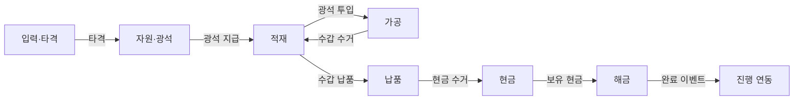
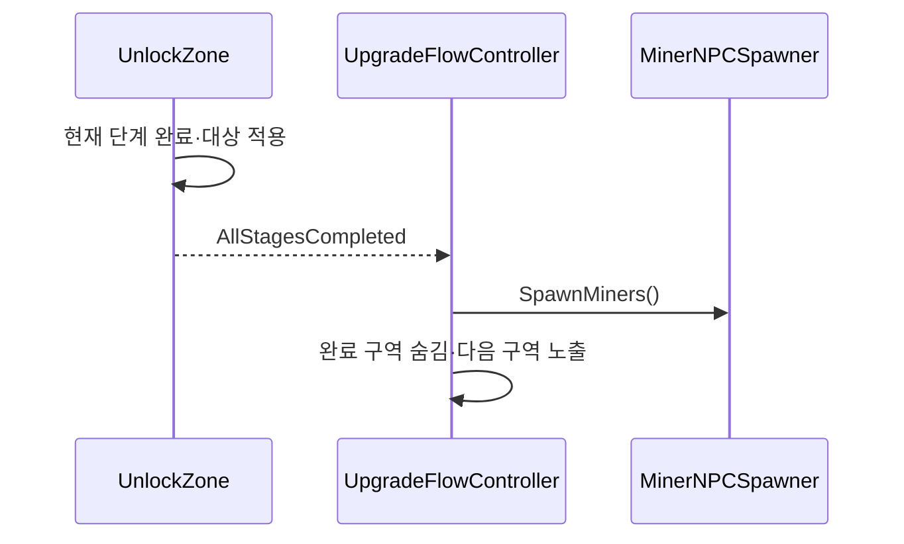
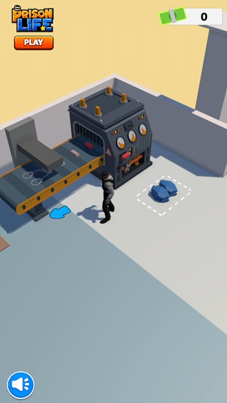
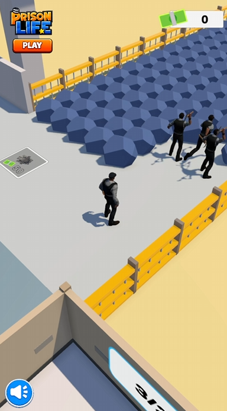
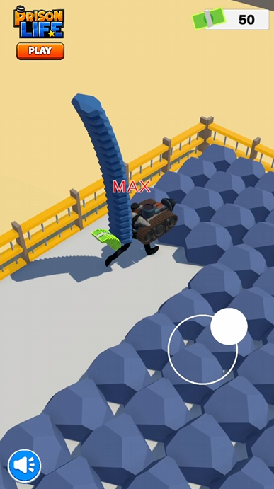

# PrisonLife

> 광석을 가공·납품해 시설과 장비를 확장하는 3D 하이퍼캐주얼 게임

| 항목 | 내용 |
|---|---|
| 장르 | 3D 하이퍼캐주얼 운영 게임 |
| 개발 기간 | 2026.04.15 ~ 2026.04.19 · 5일 |
| 개발 인원 | 1인 · AI 활용 개발 |
| 개발 환경 | Unity 2022.3.62f2, C#, URP, Git, Gemini CLI |
| 주요 사용 기술 | DOTween, Animator, uGUI·TextMeshPro, 오브젝트 풀링 |
| 화면 구성 | 세로형 720 × 1280 기준 프로젝트 설정 |
| 담당 | 씬·프리팹·Animator 설정, AI 생성 코드 검증, 기능 통합과 디버깅 |
| 링크 | [시연 영상](https://youtu.be/V64BQYYgo2c) |


*빌드 영상에서 추출한 PrisonLife 플레이 화면.*

## 1. 개요

### 1.1 게임과 개발 범위

광석을 채굴해 등에 쌓은 뒤 가공기에 넣어 수갑을 생산하는 게임입니다. 수갑을 납품해 번 현금으로 장비와 시설을 확장하고 작업 NPC를 해금합니다. 조이스틱으로 이동하며 작업 구역에 들어가면 채굴·투입·수거가 진행됩니다.

**채굴 → 적재 → 가공 → 납품 → 보상 → 업그레이드**가 이어지도록 각 기능을 구현하고 통합했습니다. 업그레이드에 따라 장비·시설과 작업 NPC가 순서대로 열리도록 했습니다.

### 1.2 담당 범위와 AI 활용

Gemini CLI로 코드를 생성·수정하고, Unity에서 씬과 리소스를 직접 설정했습니다. 생성된 코드를 검토하고 실제 플레이로 동작을 확인하며 오류를 수정했습니다.

| 구분 | 수행 내용 |
|---|---|
| 요구사항 전달 | 수정할 파일과 구현 조건, 기존 동작 중 유지할 부분을 AI에 전달 |
| Unity 작업 | 씬·프리팹 구성, Inspector 참조 연결, Animator 파라미터·전이 설정 |
| 통합과 검증 | 생성된 코드를 적용하고 플레이하면서 기능 동작과 오류 확인 |
| 문제 해결 | 오류 재현 상황을 바탕으로 AI와 수정 방향을 정하고 Unity에서 확인 |
| 외부 리소스 | DOTween, 조이스틱 및 3D·UI 에셋 활용 |

## 2. 시스템 구조

### 2.1 자원과 보상의 흐름

채굴한 광석은 적재·가공을 거쳐 수갑이 되고, 납품 보상은 현금과 업그레이드에 사용됩니다.



| 구성요소 | 주요 책임 |
|---|---|
| `PlayerController` | 조이스틱 입력, 이동·충돌, 채굴 판정, Animator 값 갱신 |
| `ResourceNode` | 자원 HP, 타격·파괴, 광석 지급, 재생성 |
| `StackManager` | 광석·수갑·현금 적재, 수거·반환, 적재물 추적 연출 |
| `Converter` | 광석 대기열, 가공 시퀀스, 생산된 수갑 관리 |
| `DeliveryDesk` | 수갑 납품, 죄수에게 전달, 현금 생성과 수거 |
| `CurrencyManager` | 보유 현금, 현금 UI, 최초 획득 튜토리얼 |
| `UnlockZone` | 단계별 비용 소모, 해금 대상 적용, 진행 UI와 완료 이벤트 |
| `UpgradeFlowController` | 해금 이후 NPC 생성, 다음 구역 노출, 시설 전환·엔딩 연결 |

### 2.2 해금 처리와 진행 연동

`UnlockZone`은 단계별 비용을 차감하고 해금을 처리합니다. `UpgradeFlowController`는 완료 이벤트를 받아 NPC를 생성하거나 다음 구역을 엽니다. 해금 비용 처리와 해금 이후의 진행을 별도 클래스에서 관리하도록 나눴습니다.



완료 이벤트는 `OnEnable`에서 구독하고 `OnDisable`에서 해제합니다. 자원 처리와 가이드 호출에는 직접 참조와 싱글톤을 사용합니다.

## 3. 핵심 기능

### 3.1 채굴·적재·가공·납품 연결

타격 시 `ResourceNode.TakeDamage(damage, playerStack)`를 호출합니다. 이미 파괴된 자원이거나 적재 대상이 없으면 처리를 끝냅니다. 타격으로 바위가 부서지면 적재 공간이 남아 있을 때만 광석을 지급합니다.

적재 공간이 가득 차면 `MAX`를 표시하고 타격은 계속 처리하지만, 광석은 지급하지 않습니다.

발췌: `ResourceNode.cs`, `TakeDamage`.

```csharp
    public void TakeDamage(int damage, StackManager playerStack)
    {
        if (isDestroyed == true || playerStack == null) return;

        if (playerStack.IsFull == true)
        {
            playerStack.ShowMaxEffect();
        }

        ApplyDamage(damage, playerStack.transform.position);

        if (currentHp <= 0)
        {
            DieForPlayer(playerStack);
        }
    }
```

`Converter`는 투입된 광석을 대기열에 쌓고, 주괴 생성과 프레스 가공을 거쳐 수갑을 생산합니다. 입구와 출구에 각각 `ConverterZone`을 두어 투입과 수거를 처리합니다. 수거한 수갑을 `DeliveryDesk`에 납품하면 현금을 얻습니다.




### 3.2 데이터와 이벤트를 이용한 단계형 업그레이드

`UnlockStage`에 단계 이름, 대상 오브젝트와 동작, 비용, 아이콘을 저장합니다. `UnlockZone`은 현재 단계의 비용과 UI를 갱신하고, 단계가 끝나면 `StageCompleted`, 전체 단계가 끝나면 `AllStagesCompleted` 이벤트를 보냅니다.

채굴 NPC 해금이 끝나면 NPC를 생성합니다. 완료된 구역은 숨기고 다음 해금 구역을 표시합니다.

발췌: `UpgradeFlowController.cs`, `HandleMinerNpcAllStagesCompleted`.

```csharp
    private void HandleMinerNpcAllStagesCompleted(UnlockZone zone)
    {
        if (minerNpcSpawner != null)
        {
            minerNpcSpawner.SpawnMiners();
        }

        if (hideMinerNpcZoneWhenComplete == true && minerNpcUpgradeZone != null)
        {
            minerNpcUpgradeZone.gameObject.SetActive(false);
        }

        if (deskNpcUnlockZone != null)
        {
            DOVirtual.DelayedCall(deskNpcUnlockDelay, () => ActivateZone(deskNpcUnlockZone));
        }
    }
```




### 3.3 반복 생성과 채굴 판정 처리

광석·주괴·수갑은 `Dictionary<string, Queue<GameObject>>` 기반 풀에서 재사용합니다. 미리 생성해 비활성화한 오브젝트를 필요할 때 꺼내 쓰고, 사용이 끝나면 비활성화해 큐에 돌려놓습니다. 풀에 남은 오브젝트가 없으면 추가로 생성합니다.

발췌: `PoolManager.cs`, `ReturnToPool`.

```csharp
    public void ReturnToPool(string tag, GameObject obj)
    {
        if (poolDictionary.ContainsKey(tag) == false) return;

        obj.SetActive(false);
        obj.transform.SetParent(transform);
        poolDictionary[tag].Enqueue(obj);
    }
```

채굴 범위의 대상은 `Physics.OverlapBoxNonAlloc`으로 조회해 재사용 배열에 받습니다. 드릴로 타격할 순서는 같은 배열에서 거리 제곱을 비교해 정렬하므로, 매번 새 목록을 만들지 않습니다.



## 4. 문제 해결과 구현 방식의 변경

### 4.1 카메라 연출 중 간헐적인 화면 끊김

**문제**

시설을 비추는 카메라 연출 중 가공이 진행되면 화면이 덜컹거렸습니다. 두 동작이 겹칠 때 카메라 위치를 바꾸는 코드를 확인했습니다.

**원인과 수정**

추적·연출 코드와 `Converter`의 `DOShakePosition`이 동시에 카메라 위치를 바꾸고 있었습니다. `Converter`에서 카메라를 직접 흔드는 호출을 제거했습니다. 흔들림은 `CameraController`에서 처리하고, 시설을 비추는 포커스 연출 중에는 흔들림 요청을 받지 않도록 했습니다.

발췌: `CameraController.cs`, `ShakeCamera`.

```csharp
    public void ShakeCamera(float duration = 0.1f, float strength = 0.1f)
    {
        if (IsFocusing) return; // 연출 중일 때는 충돌 방지를 위해 무시

        currentShakeTimer = duration;
        initialShakeDuration = duration;
        currentShakeStrength = strength;
    }
```

| 구분 | 변경 전 | 변경 후 |
|---|---|---|
| 가공 피드백 | 가공기가 카메라 Transform에 직접 흔들림 적용 | 가공 시 카메라 흔들림 호출 제거 |
| 카메라 제어 | 추적·연출과 별도 트윈이 위치에 개입 | 추적·연출과 흔들림 처리를 CameraController에서 구분 |
| 연출 우선순위 | 가공 효과와 연출이 겹칠 수 있음 | 포커스 연출 중 새 흔들림 요청 무시 |

**결과**

가공 처리에서 카메라 위치를 직접 바꾸지 않도록 수정했습니다. 포커스 연출 중에는 새 흔들림이 끼어들지 않도록 요청을 차단했습니다.

관련 변경: `a28e50f`.

### 4.2 드릴 장착 후 채굴 모션 전환 지연

**문제**

드릴을 장착한 뒤 채굴하면 곡괭이 모션이 먼저 재생되고 드릴 모션으로 늦게 전환됐습니다.

**원인**

`IsDrill`을 채굴 상태 변경 함수에서만 갱신하고 있었습니다. 채굴 상태가 이전과 같으면 함수가 먼저 종료돼, 장비를 바꿔도 Animator에 반영되지 않았습니다. 곡괭이와 드릴 모션의 진입 조건도 구분해야 했습니다.

**수정**

매 프레임 실행되는 `UpdateAnimation`에서 `IsDrill`을 갱신하도록 옮겼습니다. Animator에서는 `IsDrill` 값에 따라 곡괭이와 드릴 모션에 각각 진입하도록 조건을 나눴습니다.

발췌: `PlayerController.cs`, `UpdateAnimation`.

```csharp
    private void UpdateAnimation()
    {
        if (animator == null) return;

        animator.SetFloat(Speed, moveDirection == Vector3.zero ? 0f : 1f);
        if (equipmentManager != null)
        {
            animator.SetBool(IsDrill, equipmentManager.IsDrillEquipped);
        }
    }
```

| 전이 | 적용 조건 |
|---|---|
| `Idle_Action → MiningLoop` | `IsMining = true`, `IsDrill = false` |
| `Idle_Action → DrillLoop` | `IsMining = true`, `IsDrill = true` |

**결과**

채굴 상태가 바뀌지 않아도 장비 상태가 Animator에 반영되도록 수정했습니다. 곡괭이와 드릴 모션은 각각의 장비 조건으로 진입하도록 했습니다.

관련 변경: `34648e8`.

### 4.3 스택 이동 코드의 중복과 Update 처리 비용

광석·수갑·현금의 적재물 이동 코드를 제네릭 메서드로 합쳤다가, 리팩토링하면서 자료형별 오버로드로 나눴습니다. `Transform`, `GameObject`, `Component` 목록에서 각각 위치를 갱신하도록 했습니다.

| 방식 | 장점 | 고려할 점 |
|---|---|---|
| 제네릭 통합 | 공통 이동 로직을 한 곳에 모음 | 항목마다 자료형을 확인한 뒤 Transform에 접근 |
| 자료형별 오버로드 | 자료형에 맞춰 Transform에 접근 | 비슷한 이동 코드가 여러 메서드에 존재 |

자료형별 오버로드를 사용하면 이동 코드가 중복되는 대신, 매 프레임 자료형을 검사하지 않고 Transform에 접근할 수 있습니다.

관련 변경: `788b0b9`, `1f11eb8`.

## 5. 결과

### 5.1 구현 결과

- 채굴한 자원을 가공·납품하고 보상으로 장비와 시설을 확장하는 게임을 구현했습니다.
- 업그레이드에 따라 장비·시설과 작업 NPC를 해금하고, 가이드·카메라·엔딩 연출을 적용했습니다.
- AI로 생성한 코드를 검토하고 Unity 설정, 기능 통합, 플레이 중 디버깅을 직접 맡았습니다.
