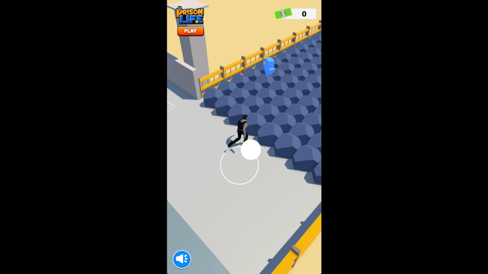
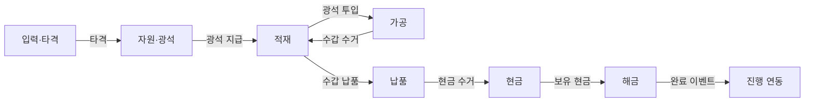
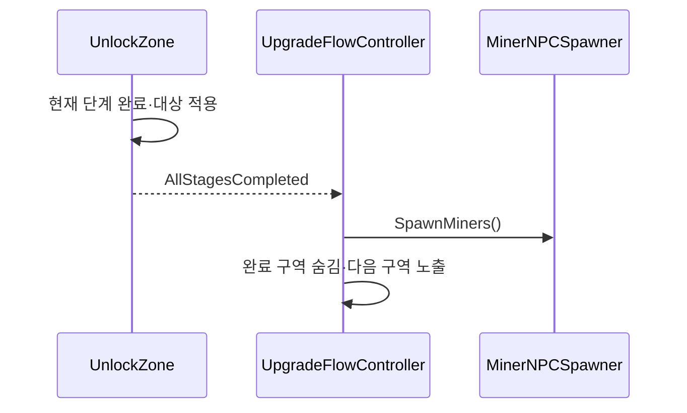
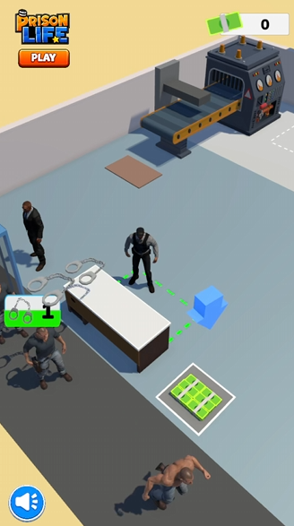
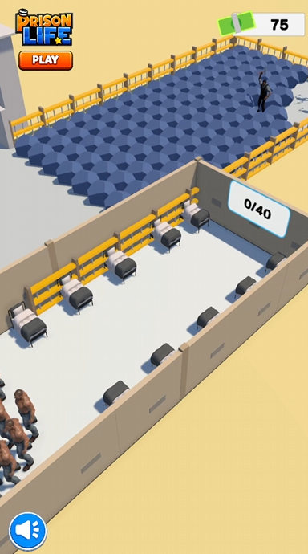
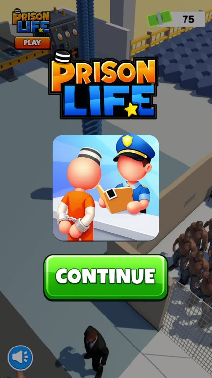

# PrisonLife

> 광석을 가공·납품해 시설과 장비를 확장하는 3D 하이퍼캐주얼 게임

| 항목 | 내용 |
|---|---|
| 장르 | 3D 하이퍼캐주얼 운영 게임 |
| 개발 기간 | 2026.04.15 ~ 2026.04.19 · 5일 |
| 개발 인원 | 1인 · AI 활용 개발 |
| 개발 환경 | Unity 2022.3.62f2, C#, URP, Git, Gemini CLI |
| 주요 사용 기술 | DOTween, Animation Event, CapsuleCast, OverlapBoxNonAlloc, C# 이벤트, 오브젝트 풀링, uGUI·TextMeshPro |
| 화면 구성 | 세로형 720 × 1280 기준 프로젝트 설정 |
| 구현 | 조이스틱 이동, 채굴·적재·가공·납품, 장비·작업 NPC·시설 해금, 카메라와 가이드 |
| 담당 | 씬·프리팹·Animator 설정, AI 생성 코드 검증, 기능 통합과 디버깅 |
| 링크 | [GitHub](https://github.com/Searabbit11/PrisonLIFE) · [시연 영상](https://youtu.be/V64BQYYgo2c) |



*빌드 영상에서 추출한 PrisonLife 플레이 화면.*

## 1. 개요

### 1.1 게임과 개발 범위

광석을 채굴해 등에 쌓은 뒤 가공기에 넣어 수갑을 생산하는 게임입니다. 수갑을 납품해 번 현금으로 장비와 시설을 확장하고 작업 NPC를 해금합니다. 조이스틱으로 이동하며 작업 구역에 들어가면 채굴·투입·수거가 진행됩니다.

**채굴 → 적재 → 가공 → 납품 → 보상 → 업그레이드**가 이어지도록 각 기능을 구현하고 통합했습니다. 업그레이드에 따라 장비·시설과 작업 NPC가 순서대로 열리도록 했습니다.

이동 입력으로 작업 구역을 오가면 광석이나 수갑이 캐릭터 등에 쌓이고, 납품 보상은 현금 더미로 나타납니다. 초반에는 플레이어가 생산과 운반을 직접 맡고, 작업 NPC를 해금하면 채굴과 수갑 운반을 각각 분담합니다.

### 1.2 담당 범위와 AI 활용

Gemini CLI로 코드를 생성·수정하고, Unity에서 씬과 리소스를 직접 설정했습니다. 생성된 코드를 검토하고 실제 플레이로 동작을 확인하며 오류를 수정했습니다.

| 구분 | 수행 내용 |
|---|---|
| 요구사항 전달 | 수정할 파일과 구현 조건, 기존 동작 중 유지할 부분을 AI에 전달 |
| Unity 작업 | 씬·프리팹 구성, Inspector 참조 연결, Animator 파라미터·전이 설정 |
| 통합과 검증 | 생성된 코드를 적용하고 플레이하면서 기능 동작과 오류 확인 |
| 문제 해결 | 오류 재현 상황을 바탕으로 AI와 수정 방향을 정하고 Unity에서 확인 |
| 외부 리소스 | DOTween, 조이스틱 및 3D·UI 에셋 활용 |

검증할 때는 스크립트만 확인하고 끝낼 수 없는 부분을 나눠 확인했습니다. 채굴 타격이 들어가는 프레임은 Animation Event에서, 드릴로 바뀌는 조건은 Animator에서, 가공기 투입·수거 위치는 씬의 트리거와 프리팹 참조에서 확인했습니다. 실제 구현을 설명할 때는 코드 발췌와 화면을 함께 남겼습니다.

## 2. 시스템 구조

### 2.1 자원과 보상의 흐름

채굴한 광석은 적재·가공을 거쳐 수갑이 되고, 납품 보상은 현금과 업그레이드에 사용됩니다.



| 구성요소 | 주요 책임 |
|---|---|
| `PlayerController` | 조이스틱 입력, 이동·충돌, 채굴 판정, Animator 값 갱신 |
| `ResourceNode` | 자원 HP, 타격·파괴, 광석 지급, 재생성 |
| `StackManager` | 광석·수갑·현금 적재, 수거·반환, 적재물 추적 연출 |
| `Converter` | 광석 대기열, 가공 시퀀스, 생산된 수갑 관리 |
| `DeliveryDesk` | 수갑 납품, 죄수에게 전달, 현금 생성과 수거 |
| `CurrencyManager` | 보유 현금, 현금 UI, 최초 획득 튜토리얼 |
| `UnlockZone` | 단계별 비용 소모, 해금 대상 적용, 진행 UI와 완료 이벤트 |
| `UpgradeFlowController` | 해금 이후 NPC 생성, 다음 구역 노출, 시설 전환·엔딩 연결 |

플레이어의 스택, 가공기 입출력, 납품대 재고는 서로 다른 목록으로 관리합니다. 구역에서 자원을 넘길 때 이전 목록에서 꺼내 새 목록에 넣고, DOTween으로 그 이동을 보여줍니다. 가공이 끝난 광석과 주괴, 전달이 끝난 수갑은 풀에 돌려줍니다. 납품으로 생성한 현금은 플레이어가 수거했을 때 잔액에 반영됩니다.

### 2.2 해금 처리와 진행 연동

`UnlockZone`은 단계별 비용을 차감하고 해금을 처리합니다. `UpgradeFlowController`는 완료 이벤트를 받아 NPC를 생성하거나 다음 구역을 엽니다. 해금 비용 처리와 해금 이후의 진행을 별도 클래스에서 관리하도록 나눴습니다.



완료 이벤트는 `OnEnable`에서 구독하고 `OnDisable`에서 해제합니다. 자원 처리와 가이드 호출에는 직접 참조와 싱글톤을 사용합니다.

## 3. 핵심 기능

### 3.1 채굴·적재·가공·납품 연결

타격 시 `ResourceNode.TakeDamage(damage, playerStack)`를 호출합니다. 이미 파괴된 자원이거나 적재 대상이 없으면 처리를 끝냅니다. 타격으로 바위가 부서지면 적재 공간이 남아 있을 때만 광석을 지급합니다.

적재 공간이 가득 차면 `MAX`를 표시하고 타격은 계속 처리하지만, 광석은 지급하지 않습니다.

발췌: [ResourceNode.cs](https://github.com/Searabbit11/PrisonLIFE/blob/ff586a3810c65cfb45e037d79de192a6245f1eed/Assets/01.%20Script/Interactable/ResourceNode.cs), `TakeDamage`.

```csharp
    public void TakeDamage(int damage, StackManager playerStack)
    {
        if (isDestroyed == true || playerStack == null) return;

        if (playerStack.IsFull == true)
        {
            playerStack.ShowMaxEffect();
        }

        ApplyDamage(damage, playerStack.transform.position);

        if (currentHp <= 0)
        {
            DieForPlayer(playerStack);
        }
    }
```

`Converter`는 투입된 광석을 대기열에 쌓고, 주괴 생성과 프레스 가공을 거쳐 수갑을 생산합니다. 입구와 출구에 각각 `ConverterZone`을 두어 투입과 수거를 처리합니다. 수거한 수갑을 `DeliveryDesk`에 납품하면 현금을 얻습니다.

**조이스틱 이동과 채굴 시작**

조이스틱 입력이 데드존을 넘으면 카메라의 Y축 회전에 맞춰 이동 방향을 구합니다. `CapsuleCast`로 이동 경로를 검사해 벽과의 여유 거리를 남기고, 이동량이 남으면 벽면을 따라 움직일 방향을 한 번 더 계산합니다. 작업 구역 트리거는 이동 충돌에서 제외하고, 채굴 구역 안에 자원이 있는지는 별도 박스 검사로 판단합니다.

채굴 타격은 애니메이션에서 `OnMiningHit`가 호출되는 시점에 적용합니다. 곡괭이는 탐지한 자원 중 가까운 하나를 선택하고, 드릴은 범위 안의 자원을 가까운 순으로 차례로 타격합니다. `ResourceNode`는 HP가 0이 되면 모델과 콜라이더를 잠시 비활성화하고, 재생성 시간이 지나면 다시 채굴할 수 있게 합니다.

**가공기의 투입·가공·배출**

| 단계 | 코드에서 처리하는 방식 |
|---|---|
| 투입 | `ConverterZone`의 입구에 머물면 정해진 간격으로 광석을 하나씩 내려놓습니다. 입구가 가득 차면 플레이어 스택에서 꺼내기 전에 `MAX`를 띄웁니다. |
| 광석 도착 | 투입한 광석을 적재 목록과 이동 중인 집합에 등록합니다. 점프 연출이 끝난 뒤 집합에서 제거해, 아직 입구로 이동 중인 광석이 제련에 들어가는 것을 막습니다. |
| 제련과 프레스 | 적재 목록 끝의 광석을 제련 지점으로 옮기고 풀에 반환합니다. 벨트 입구에서 주괴를 꺼내 프레스까지 보낸 뒤, 프레스가 내려간 시점에 주괴를 수갑으로 바꿉니다. |
| 배출과 수거 | 수갑이 벨트 끝에 도착하면 배출 목록에 추가합니다. 배출 구역에 머무는 플레이어나 작업 NPC가 수갑을 꺼내 자신의 스택에 넣습니다. |

`rawOresOnFloor`는 투입된 광석, `rawOresInTransit`은 아직 입구로 이동하는 광석을 추적합니다. 두 상태를 나눠 투입 연출의 완료와 실제 가공 시작을 연결했습니다. 주괴가 달궈지는 효과는 `MaterialPropertyBlock`으로 렌더러의 색만 잠시 바꾼 뒤 원래 색으로 복원합니다.

```csharp
if (rawOresInTransit.Contains(oreToProcess))
{
    return;
}

rawOresOnFloor.RemoveAt(lastIndex);
rawOresInTransit.Remove(oreToProcess);

nextProcessTime = Time.time + processCooldown;
```


**납품 후 현금이 생기고 잔액에 반영되기까지**

납품대에 들어가면 플레이어의 수갑을 일정 간격으로 데스크에 옮깁니다. `DeliveryDesk`는 대기열 첫 NPC가 수갑을 받을 수 있을 때만 데스크에서 수갑을 하나 꺼냅니다. 수갑이 NPC에게 도착하면 오브젝트를 풀에 돌려주고, `ReceiveHandcuff()`를 호출해 필요한 수량을 줄입니다.

필요한 수량이 0이 된 NPC는 짧은 대기 후 대기열에서 나가고, 최초 요구량을 기준으로 현금을 생성합니다. 플레이어가 현금 수거 구역에 들어가면 `StackManager.PushCash`에서 현금 오브젝트를 적재하고 `CurrencyManager.AddCash`를 호출합니다. 그래서 수갑이 전달되는 순간, 현금이 바닥에 쌓이는 순간, 화면의 잔액이 올라가는 순간이 구분됩니다.



<figure class="pf-figure" style="max-width: min(100%, 350px); margin-inline: auto;">
  <video src="images/processing-to-payout.mp4" poster="images/processing-to-payout-poster.jpg" controls playsinline preload="none" aria-label="광석 투입부터 첫 현금 수거까지의 시연" style="display: block; width: 100%; height: auto;"></video>
  <figcaption>광석을 투입한 뒤 배출된 수갑을 수거·납품하고 첫 현금을 받는 장면.</figcaption>
</figure>

### 3.2 데이터와 이벤트를 이용한 단계형 업그레이드

`UnlockStage`에 단계 이름, 대상 오브젝트와 동작, 비용, 아이콘을 저장합니다. `UnlockZone`은 현재 단계의 비용과 UI를 갱신하고, 단계가 끝나면 `StageCompleted`, 전체 단계가 끝나면 `AllStagesCompleted` 이벤트를 보냅니다.

채굴 NPC 해금이 끝나면 NPC를 생성합니다. 완료된 구역은 숨기고 다음 해금 구역을 표시합니다.

발췌: [UpgradeFlowController.cs](https://github.com/Searabbit11/PrisonLIFE/blob/ff586a3810c65cfb45e037d79de192a6245f1eed/Assets/01.%20Script/Core/UpgradeFlowController.cs), `HandleMinerNpcAllStagesCompleted`.

```csharp
    private void HandleMinerNpcAllStagesCompleted(UnlockZone zone)
    {
        if (minerNpcSpawner != null)
        {
            minerNpcSpawner.SpawnMiners();
        }

        if (hideMinerNpcZoneWhenComplete == true && minerNpcUpgradeZone != null)
        {
            minerNpcUpgradeZone.gameObject.SetActive(false);
        }

        if (deskNpcUnlockZone != null)
        {
            DOVirtual.DelayedCall(deskNpcUnlockDelay, () => ActivateZone(deskNpcUnlockZone));
        }
    }
```




#### 비용 처리와 해금 이후 행동

`UnlockRoutine`은 구역을 사용할 수 있는 플레이어인지 확인한 뒤 현금 스택에서 지폐를 하나씩 꺼냅니다. 지폐 한 묶음의 금액만큼 해금 진행도를 올리고 잔액을 차감합니다. 단계를 완료하면 다음 아이콘과 비용을 갱신합니다. `ZoneOwnerByPlayer`는 같은 플레이어의 현금 소비가 여러 해금 구역에서 동시에 시작되는 것을 막습니다.

| 해금 조건 | 이어지는 변화 |
|---|---|
| 장비 단계 완료 | `EquipmentManager`가 장비 프리팹을 소켓에 연결합니다. 같은 단계에서 최대 광석 적재량과 채굴 탐지 범위도 늘립니다. |
| 첫 드릴 단계 완료 | 다음 단계의 현금 소모를 잠시 막고, 지연 후 채굴 NPC 해금 구역을 표시합니다. |
| 채굴 NPC 해금 완료 | 채굴 NPC를 생성하고 완료 구역을 숨깁니다. 이후 수갑 운반을 맡는 NPC의 해금 구역을 표시합니다. |
| 수용 시설 해금 완료 | 기존 시설의 표시를 끄고 확장 시설을 켭니다. 수용 인원 상한과 슬롯을 갱신하고, 카메라가 확장 시설을 비춘 뒤 엔딩 UI를 표시합니다. |

### 3.3 반복 생성과 채굴 판정 처리

광석·주괴·수갑은 `Dictionary<string, Queue<GameObject>>` 기반 풀에서 재사용합니다. 미리 생성해 비활성화한 오브젝트를 필요할 때 꺼내 쓰고, 사용이 끝나면 비활성화해 큐에 돌려놓습니다. 풀에 남은 오브젝트가 없으면 추가로 생성합니다.

발췌: [PoolManager.cs](https://github.com/Searabbit11/PrisonLIFE/blob/ff586a3810c65cfb45e037d79de192a6245f1eed/Assets/01.%20Script/Core/PoolManager.cs), `ReturnToPool`.

```csharp
    public void ReturnToPool(string tag, GameObject obj)
    {
        if (poolDictionary.ContainsKey(tag) == false) return;

        obj.SetActive(false);
        obj.transform.SetParent(transform);
        poolDictionary[tag].Enqueue(obj);
    }
```

채굴 범위의 대상은 `Physics.OverlapBoxNonAlloc`으로 조회해 재사용 배열에 받습니다. 드릴로 타격할 순서는 같은 배열에서 거리 제곱을 비교해 정렬하므로, 매번 새 목록을 만들지 않습니다.

현금도 같은 풀에서 꺼내고, 해금 구역에서 소비 연출이 끝나면 돌려줍니다. 적재물에 남아 있는 이동 트윈은 옮기기 전에 중지하고, 다음 위치의 기준 Transform으로 부모를 바꿉니다. `StackManager`는 광석·수갑·현금 각각의 높이 간격과 기준점을 사용하고, 이동 속도와 방향으로 스택의 휘어짐을 계산합니다.

탐지 배열은 코드에서 32칸으로 고정됩니다. 할당을 줄이는 대신 배열 크기를 넘는 장면에서는 모든 자원을 같은 호출에서 처리한다는 보장이 없습니다. 두 드릴의 탐지 범위와 자원 배치를 함께 확인해야 하는 지점입니다.


### 3.4 작업 NPC와 시설 진행

- **채굴 NPC**는 배정된 작업 줄에서 채굴 대상을 고릅니다. 자원이 파괴돼 광석이 나오면 가공기에 직접 전달하고 다음 대상으로 이동합니다.
- **운반 NPC**는 가공기에서 수갑이 나올 때까지 기다렸다가 수거 지점으로 이동합니다. 수갑을 담은 뒤 납품대로 이동해 같은 납품대 적재 처리에 넘깁니다.
- **대기 NPC**는 필요한 수갑을 모두 받으면 지정된 경로를 따라 빈 수용 슬롯으로 이동합니다. 입구 트리거를 통과할 때 인원 표시가 올라갑니다. 빈 슬롯이 없으면 시설 확장 구역을 표시하는 흐름으로 이어집니다.

### 3.5 첫 보상 가이드와 엔딩 연출

`GuideManager`는 첫 광석 채굴·투입, 수갑 수거와 납품, 현금 수거에 맞춰 화면의 화살표를 바꿉니다. 처음 현금을 획득하면 `CurrencyManager`가 이동과 카메라 추적을 잠시 멈추고 첫 해금 구역을 보여준 뒤 이전 상태를 복원합니다.

시설 확장에서는 `UpgradeFlowController`가 카메라의 `IsFocusing`이 해제되기를 기다린 뒤 `EndingUIController.ShowEnding()`을 호출합니다. 시설 변화가 먼저 보이고 그 뒤 엔딩 UI가 나타납니다.



## 4. 문제 해결과 구현 방식의 변경

### 4.1 카메라 연출 중 간헐적인 화면 끊김

**문제**

시설을 비추는 카메라 연출 중 가공이 진행되면 화면이 덜컹거렸습니다. 두 동작이 겹칠 때 카메라 위치를 바꾸는 코드를 확인했습니다.

**원인과 수정**

추적·연출 코드와 `Converter`의 `DOShakePosition`이 동시에 카메라 위치를 바꾸고 있었습니다. `Converter`에서 카메라를 직접 흔드는 호출을 제거했습니다. 흔들림은 `CameraController`에서 처리하고, 시설을 비추는 포커스 연출 중에는 흔들림 요청을 받지 않도록 했습니다.

발췌: [CameraController.cs](https://github.com/Searabbit11/PrisonLIFE/blob/ff586a3810c65cfb45e037d79de192a6245f1eed/Assets/01.%20Script/UI/CameraController.cs), `ShakeCamera`.

```csharp
    public void ShakeCamera(float duration = 0.1f, float strength = 0.1f)
    {
        if (IsFocusing) return; // 연출 중일 때는 충돌 방지를 위해 무시

        currentShakeTimer = duration;
        initialShakeDuration = duration;
        currentShakeStrength = strength;
    }
```

| 구분 | 변경 전 | 변경 후 |
|---|---|---|
| 가공 피드백 | 가공기가 카메라 Transform에 직접 흔들림 적용 | 가공 시 카메라 흔들림 호출 제거 |
| 카메라 제어 | 추적·연출과 별도 트윈이 위치에 개입 | 추적·연출과 흔들림 처리를 CameraController에서 구분 |
| 연출 우선순위 | 가공 효과와 연출이 겹칠 수 있음 | 포커스 연출 중 새 흔들림 요청 무시 |

**결과**

가공 처리에서 카메라 위치를 직접 바꾸지 않도록 수정했습니다. 포커스 연출 중에는 새 흔들림이 끼어들지 않도록 요청을 차단했습니다.

관련 변경: `a28e50f`.

이 사례에서 확인한 기준은 카메라 위치를 쓰는 코드의 소유권이었습니다. 시설 포커스, 일반 추적, 타격 흔들림은 같은 Transform을 사용하므로 어느 상태에서 어떤 효과가 우선하는지 명확히 해야 했습니다.

### 4.2 드릴 장착 후 채굴 모션 전환 지연

**문제**

드릴을 장착한 뒤 채굴하면 곡괭이 모션이 먼저 재생되고 드릴 모션으로 늦게 전환됐습니다.

**원인**

`IsDrill`을 채굴 상태 변경 함수에서만 갱신하고 있었습니다. 채굴 상태가 이전과 같으면 함수가 먼저 종료돼, 장비를 바꿔도 Animator에 반영되지 않았습니다. 곡괭이와 드릴 모션의 진입 조건도 구분해야 했습니다.

**수정**

매 프레임 실행되는 `UpdateAnimation`에서 `IsDrill`을 갱신하도록 옮겼습니다. Animator에서는 `IsDrill` 값에 따라 곡괭이와 드릴 모션에 각각 진입하도록 조건을 나눴습니다.

발췌: [PlayerController.cs](https://github.com/Searabbit11/PrisonLIFE/blob/ff586a3810c65cfb45e037d79de192a6245f1eed/Assets/01.%20Script/Player/PlayerController.cs), `UpdateAnimation`.

```csharp
    private void UpdateAnimation()
    {
        if (animator == null) return;

        animator.SetFloat(Speed, moveDirection == Vector3.zero ? 0f : 1f);
        if (equipmentManager != null)
        {
            animator.SetBool(IsDrill, equipmentManager.IsDrillEquipped);
        }
    }
```

| 전이 | 적용 조건 |
|---|---|
| `Idle_Action → MiningLoop` | `IsMining = true`, `IsDrill = false` |
| `Idle_Action → DrillLoop` | `IsMining = true`, `IsDrill = true` |

**결과**

채굴 상태가 바뀌지 않아도 장비 상태가 Animator에 반영되도록 수정했습니다. 곡괭이와 드릴 모션은 각각의 장비 조건으로 진입하도록 했습니다.

관련 변경: `34648e8`.

재현 조건은 **채굴 상태를 유지한 채 장비만 바뀌는 상황**입니다. 코드에서 장비값을 갱신하는 지점과 Animator의 실제 전이 조건을 함께 확인해야 해결되는 문제였습니다.

### 4.3 스택 이동 코드의 중복과 Update 처리 비용

광석·수갑·현금의 적재물 이동 코드를 제네릭 메서드로 합쳤다가, 리팩토링하면서 자료형별 오버로드로 나눴습니다. `Transform`, `GameObject`, `Component` 목록에서 각각 위치를 갱신하도록 했습니다.

| 방식 | 장점 | 고려할 점 |
|---|---|---|
| 제네릭 통합 | 공통 이동 로직을 한 곳에 모음 | 항목마다 자료형을 확인한 뒤 Transform에 접근 |
| 자료형별 오버로드 | 자료형에 맞춰 Transform에 접근 | 비슷한 이동 코드가 여러 메서드에 존재 |

자료형별 오버로드를 사용하면 이동 코드가 중복되는 대신, 매 프레임 자료형을 검사하지 않고 Transform에 접근할 수 있습니다.

현재 갱신 경로에서 광석은 `List<Transform>`, 수갑과 현금은 `List<GameObject>` 오버로드를 사용합니다. 코드 변경으로 확인한 결과는 프레임마다 자료형을 검사하던 경로를 바꾼 것입니다. 이 변경의 실행 시간이나 GC 개선량은 수치로 제시할 근거가 없습니다.

관련 변경: `788b0b9`, `1f11eb8`.

## 5. 결과

### 5.1 구현 결과

- 채굴한 자원을 가공·납품하고 보상으로 장비와 시설을 확장하는 게임을 구현했습니다.
- 업그레이드에 따라 장비·시설과 작업 NPC를 해금하고, 가이드·카메라·엔딩 연출을 적용했습니다.
- AI로 생성한 코드를 검토하고 Unity 설정, 기능 통합, 플레이 중 디버깅을 직접 맡았습니다.

### 5.2 설계에서 확인한 점

광석 투입, 프레스 가공, 수갑 전달은 화면에서는 하나의 연출처럼 보입니다. 코드에서는 **자원 목록이 바뀌는 시점**과 **이동 연출이 끝나는 시점**을 각각 관리합니다. 가공기 앞의 이동 중 목록과 납품대의 도착 콜백은 두 시점을 연결하는 사례입니다.

카메라 흔들림과 드릴 모션 문제는 각각 여러 코드가 같은 Transform을 바꾸는 상황과, 장비가 바뀌어도 기존 상태값이 유지되는 상황에서 생겼습니다. 최종 상태를 확인하려면 코드의 값뿐 아니라 Inspector 참조, Animator 전이, 실행 중인 트윈을 같이 점검해야 합니다.

### 5.3 회고와 개선 방향

5일 동안 채굴부터 첫 현금 획득, 장비와 NPC 해금, 시설 확장까지 한 번의 플레이로 이어지도록 통합했습니다. AI에 구현 조건과 유지해야 할 동작을 전달하고, Unity에서 연결한 뒤 실제 플레이로 확인하는 방식으로 작업했습니다.

추가 검증 항목은 적재 한도에 도달한 상태에서의 채굴, 플레이어와 NPC가 같은 가공기를 사용할 때의 투입·수거, 카메라 포커스 중 가공이 이어지는 상황입니다. 최적화 효과를 비교하려면 같은 장면에서 적재량과 화면에 표시되는 자원을 맞추고 Unity Profiler로 프레임 시간과 GC 할당을 측정해야 합니다.

### 5.4 코드와 변경 기록

| 확인 항목 | Git 소스 |
|---|---|
| 플레이어 이동·드릴·적재 | [PlayerController.cs](https://github.com/Searabbit11/PrisonLIFE/blob/ff586a3810c65cfb45e037d79de192a6245f1eed/Assets/01.%20Script/Player/PlayerController.cs) · [StackManager.cs](https://github.com/Searabbit11/PrisonLIFE/blob/ff586a3810c65cfb45e037d79de192a6245f1eed/Assets/01.%20Script/Player/StackManager.cs) |
| 자원 입출력과 가공 | [ResourceNode.cs](https://github.com/Searabbit11/PrisonLIFE/blob/ff586a3810c65cfb45e037d79de192a6245f1eed/Assets/01.%20Script/Interactable/ResourceNode.cs) · [Converter.cs](https://github.com/Searabbit11/PrisonLIFE/blob/ff586a3810c65cfb45e037d79de192a6245f1eed/Assets/01.%20Script/Interactable/Converter.cs) · [PoolManager.cs](https://github.com/Searabbit11/PrisonLIFE/blob/ff586a3810c65cfb45e037d79de192a6245f1eed/Assets/01.%20Script/Core/PoolManager.cs) |
| 납품 후 보상과 잔액 | [DeliveryDesk.cs](https://github.com/Searabbit11/PrisonLIFE/blob/ff586a3810c65cfb45e037d79de192a6245f1eed/Assets/01.%20Script/Interactable/DeliveryDesk.cs) · [Criminal.cs](https://github.com/Searabbit11/PrisonLIFE/blob/ff586a3810c65cfb45e037d79de192a6245f1eed/Assets/01.%20Script/NPC/Criminal.cs) · [CurrencyManager.cs](https://github.com/Searabbit11/PrisonLIFE/blob/ff586a3810c65cfb45e037d79de192a6245f1eed/Assets/01.%20Script/Core/CurrencyManager.cs) |
| 해금과 후속 진행 | [UnlockZone.cs](https://github.com/Searabbit11/PrisonLIFE/blob/ff586a3810c65cfb45e037d79de192a6245f1eed/Assets/01.%20Script/Interactable/UnlockZone.cs) · [UpgradeFlowController.cs](https://github.com/Searabbit11/PrisonLIFE/blob/ff586a3810c65cfb45e037d79de192a6245f1eed/Assets/01.%20Script/Core/UpgradeFlowController.cs) |
| 작업 NPC의 채굴과 수거 | [MinerNPC.cs](https://github.com/Searabbit11/PrisonLIFE/blob/ff586a3810c65cfb45e037d79de192a6245f1eed/Assets/01.%20Script/NPC/MinerNPC.cs) · [DeskNPC.cs](https://github.com/Searabbit11/PrisonLIFE/blob/ff586a3810c65cfb45e037d79de192a6245f1eed/Assets/01.%20Script/NPC/DeskNPC.cs) |

- 카메라 연출 충돌 수정 [`a28e50f`](https://github.com/Searabbit11/PrisonLIFE/commit/a28e50f)
- 드릴 모션과 Animator 전이 수정 [`34648e8`](https://github.com/Searabbit11/PrisonLIFE/commit/34648e8)
- 스택 갱신 코드 통합 [`788b0b9`](https://github.com/Searabbit11/PrisonLIFE/commit/788b0b9)
- 자료형별 스택 갱신과 채굴 판정 정리 [`1f11eb8`](https://github.com/Searabbit11/PrisonLIFE/commit/1f11eb8)
