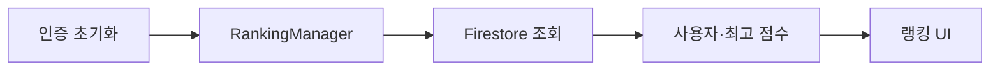
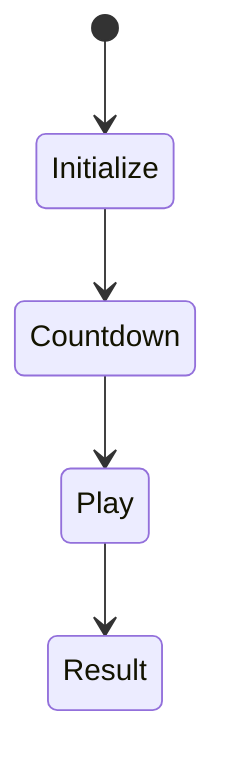
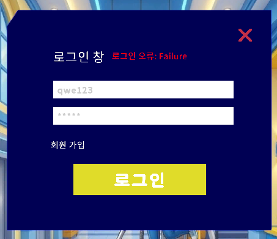
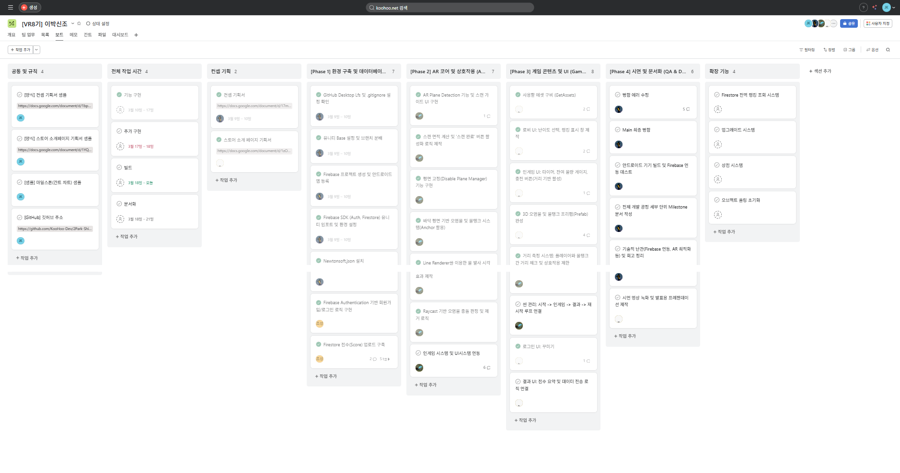

# 방 꼴이 이게 뭐니?!

> 현실 공간의 오염물을 청소하는 4인 팀 AR 게임

| 항목 | 내용 |
|---|---|
| 장르 | AR 캐주얼 청소 슈팅 |
| 개발 기간 | 2026.03 · 2주 |
| 개발 인원 | 4인 팀 프로젝트 |
| 개발 환경 | Unity 6000.3.10f1, C#, Firebase, UniTask |
| 플랫폼 | Android |
| 주요 기술 | Firebase 연동, Firestore 랭킹, 상태 기반 게임 흐름, Git 협업 |
| 내 역할 | 팀장·PM, Firebase 연동·랭킹·게임 진행, Git 관리와 오류 해결 |
| 링크 | [GitHub](https://github.com/Searabbit11/-AR-What-happened-in-your-room-) · [시연 영상](https://youtu.be/Fu9_N_SvFIg) · [기술 문서 PDF](https://drive.google.com/file/d/1GdKdLITRFBCQQrgyDxzWBgsXXY38_AER/view) |

## 1. 개요

### 1.1 게임과 담당 범위

현실 공간의 오염물을 청소하며 제한 시간 안에 점수를 얻는 AR 게임입니다. 팀장·PM으로 일정과 Git 작업을 관리하고, Firebase 연동·랭킹·게임 진행을 맡았습니다.

팀원이 구현한 기능을 프로젝트에 통합하고, 개발 중 막힌 오류를 함께 점검해 해결했습니다.

## 2. 담당 시스템 구조

### 2.1 Firebase와 랭킹 연결

Firebase 인증 초기화가 끝나면 Firestore에서 사용자 이름과 최고 점수를 조회해 랭킹 UI에 전달합니다.

### 2.2 준비부터 결과까지의 게임 흐름

게임 진행을 초기화·카운트다운·플레이·결과 상태로 나눴습니다. InGameSystem은 상태를 바꿀 때 이전 상태를 종료한 뒤 다음 상태를 시작합니다.

## 3. 담당 기능과 프로젝트 운영

### 3.1 Firebase 연결과 랭킹

Firebase 인증과 Firestore를 연동하고 랭킹 조회 결과를 화면에 표시했습니다. RankingManager는 인증 초기화를 기다린 뒤 bestScore가 높은 순으로 랭킹 데이터를 조회합니다.

조회한 사용자 이름과 최고 점수를 UI에 표시합니다. 인증 초기화가 끝난 뒤 조회하도록 순서를 맞췄습니다.

### 3.2 게임 상태와 화면 연결

준비·플레이·결과 화면이 각 게임 상태에 맞게 동작하도록 구현했습니다. Firebase·랭킹을 화면에 연동하고 팀원이 구현한 기능을 합치면서 발생한 오류를 수정했습니다.

### 3.3 일정·Git·개발 환경 관리

기획·개발 일정을 마일스톤으로 관리하고, 팀의 브랜치 작업과 병합을 맡았습니다. 패키지 버전 불일치와 씬 충돌을 해결하고, 팀이 같은 환경에서 작업하도록 패키지 버전과 도입 기준을 정했습니다.

## 4. 협업 문제 해결

### 4.1 XR 패키지 버전 혼재와 컴파일 오류

**문제:** XR Interaction Toolkit과 샘플의 버전이 섞여 StarterAssets 참조 오류가 발생했습니다.

**원인:** manifest.json, packages-lock.json과 샘플 리소스가 서로 다른 버전을 가리키고 있었습니다.

**해결:** 패키지 정의와 잠금 파일, 샘플 리소스를 모두 3.3.0 기준으로 맞췄습니다.

**결과:** 팀 전체가 같은 XR 패키지와 샘플 버전을 사용하도록 정리했습니다.

### 4.2 Git LFS와 병합·씬 충돌 대응

**문제:** Git LFS 할당량이 소진되고 브랜치·씬 충돌까지 발생해 작업 내용을 동기화하거나 합칠 수 없었습니다.

**해결:** LFS 할당량을 확보한 뒤 정상 상태의 develop 브랜치를 기준으로 작업 내용을 다시 맞췄습니다. 충돌한 씬은 정상 시점으로 복원하고 필요한 오브젝트를 다시 배치했습니다.

**결과:** 병합 기준이 되는 브랜치와 씬을 복구했습니다. 이후 씬 분할과 프리팹 단위 작업, 외부 패키지 도입 기준을 정리했습니다.

### 4.3 UniTask 중복 설치 정리

**문제:** UniTask 패키지와 직접 가져온 소스가 중복 설치돼 클래스 참조와 컴파일 오류가 발생했습니다.

**해결:** 중복된 소스와 메타 파일을 정리하고 UniTask를 가져오는 경로를 하나로 통일했습니다.

**결과:** UniTask가 한 경로에서만 참조되도록 정리했습니다.

## 5. 결과

### 5.1 기여 결과

- Firebase 인증 초기화부터 랭킹 조회·표시까지 연동했습니다.
- 게임 진행과 화면을 연동하고, 팀장·PM으로 일정과 기능 통합을 관리했습니다.
- Git LFS, XR 패키지 버전, UniTask 중복 설치와 씬 충돌 문제를 해결했습니다.
