# 방 꼴이 이게 뭐니?!

> 실제 방을 스캔하고 가상의 물총으로 오염물을 청소하는 Android AR 게임

| 항목 | 내용 |
|---|---|
| 장르 | AR 캐주얼 청소 슈팅 |
| 개발 기간 | 2026.03 · 2주 |
| 개발 인원 | 4인 팀 프로젝트 |
| 개발 환경 | Unity 6000.3.10f1, C#, Firebase, UniTask |
| 플랫폼 | Android |
| 주요 기술 | AR Foundation, AABB, 상태 패턴, 틱 기반 판정, Firebase·Firestore, UniTask |
| 구현 | AR 공간 스캔, 게임 상태 전환, 청소 판정과 물 자원, Firebase 인증·랭킹 연동 |
| 팀 내 역할 | 팀장·PM, 마일스톤·브랜치 관리와 기능 통합 |
| 링크 | [GitHub](https://github.com/Searabbit11/-AR-What-happened-in-your-room-) · [시연 영상](https://youtu.be/Fu9_N_SvFIg) · [기술 문서 PDF](https://drive.google.com/file/d/1GdKdLITRFBCQQrgyDxzWBgsXXY38_AER/view) |

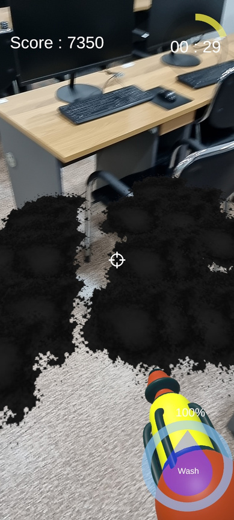

## 1. 개요

### 1.1 게임과 담당 범위

현실 공간의 오염물을 청소하며 제한 시간 안에 점수를 얻는 AR 게임입니다.

AR 평면을 스캔해 플레이 공간을 만들고, 상태 전환·청소 판정·물 자원을 구현했습니다. Firebase 랭킹을 연동하고 팀장·PM으로 일정과 Git 병합을 관리했습니다.

팀원이 구현한 기능을 프로젝트에 통합하고, 개발 중 막힌 오류를 함께 점검해 해결했습니다.

### 1.2 플레이 흐름과 기획 의도

방을 치운다는 익숙한 목표와 물총 조작으로 짧게 즐길 수 있는 모바일 미니게임을 기획했습니다. 카메라로 비춘 실제 공간에 오염물을 놓고, 물을 쏜 자리가 깨끗해지는 반응으로 물청소의 만족감을 보여주려 했습니다.

1. 스마트폰으로 바닥을 비추면 스캔 진행률이 올라갑니다.
2. 기준 면적에 도달하면 준비 단계를 거쳐 오염물과 물탱크가 배치됩니다.
3. 제한 시간 안에 물총으로 오염물을 지우고 점수를 올립니다. 물이 떨어지면 물탱크로 이동해 충전합니다.
4. 점수를 확인한 뒤 다시 스캔해 재도전하거나, 로비로 돌아가 최고 기록을 갱신합니다.

| 시작 화면 | 실제 방에서 플레이하는 모습 |
|---|---|
| 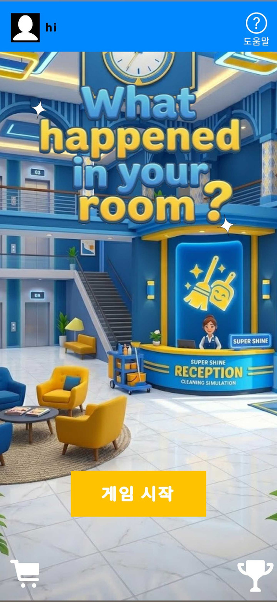 | 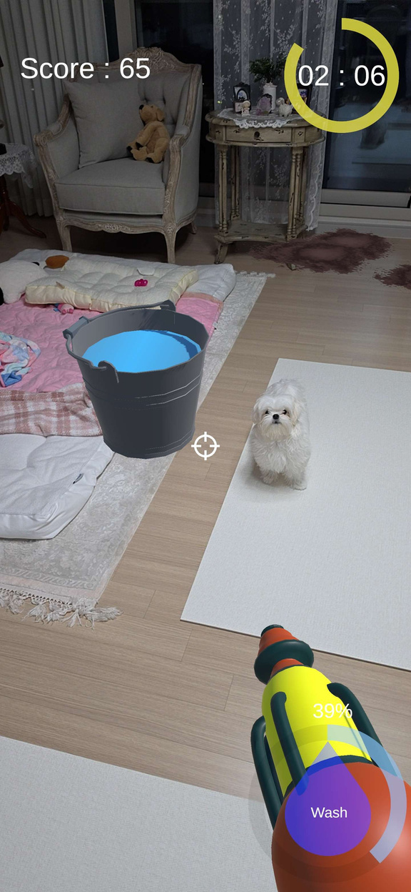 |

## 2. 담당 시스템 구조

### 2.1 Firebase와 랭킹 연결

RankingManager는 Firebase 인증 초기화를 기다려 Firestore를 연결합니다. 랭킹 조회 시 bestScore 기준 내림차순으로 요청한 개수만 조회합니다.

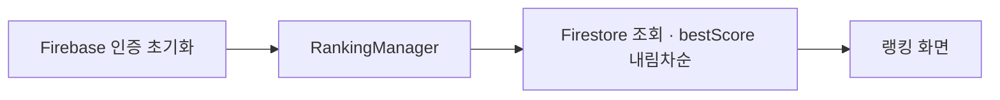

### 2.2 준비부터 결과까지의 게임 흐름

플레이 흐름은 준비·진행·결과로 구성했습니다. 코드에서는 준비를 초기화와 카운트다운으로 나누고, InGameSystem이 이전 상태를 종료한 뒤 다음 상태에 진입하도록 했습니다. 각 상태가 화면과 입력을 단계별로 관리해 플레이 중 결과 창이 먼저 뜨는 일을 방지했습니다.

```csharp
currentState?.ExitState();
currentState = stateDictionary[nextType];
currentState.EnterState();
```

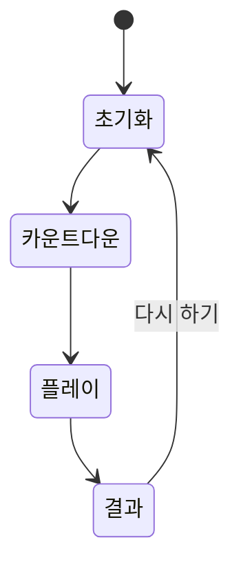

### 2.3 인게임 구성요소와 역할

| 구성요소 | 책임 |
|---|---|
| `ARScanProvider` | 평면 변경을 받아 면적과 스캔 진행률을 계산 |
| `InGameSystem` | 초기화, 카운트다운, 플레이, 결과 전환과 조작 잠금 |
| `GameStatusController` | 스캔율·물·점수·타이머를 보관하고 변경을 UI에 알림 |
| `ARObjectSpawner` · `WaterTankSystem` | 스캔된 평면 위에 난이도별 오염물과 충전 지점 배치 |
| `WaterGun` · `CleanupHitBox` | 분사와 물 잔량을 제어하고 대상별 세척 이벤트 생성 |
| `CleanupSystem` · `DustBase` | 콜라이더로 세척 대상을 찾아 내구도를 깎고 제거·점수를 반영 |
| `FirebaseAuthManager` · `FirebaseFirestoreManager` | 인증 초기화, 로컬·클라우드 프로필 조회와 최고 점수 저장 |
| `RankingManager` · `RankingUI` | 최고 점수 순위 조회, 로딩·빈 목록 표시와 내 기록 강조 |

## 3. 담당 기능과 프로젝트 운영

### 3.1 Firebase 연결과 랭킹

회원가입·로그인 오류를 안내하고, 랭킹 화면에 이용자별 최고 기록을 표시합니다.

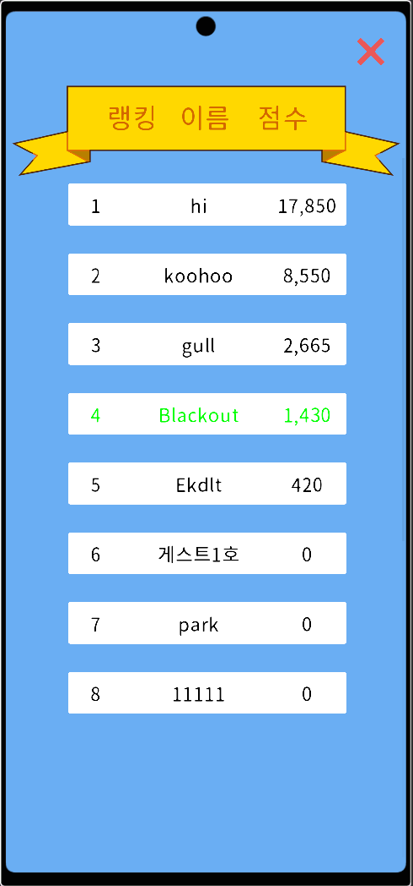

랭킹은 bestScore를 기준으로 조회합니다. 사용자 정보와 플레이 기록은 기기에 JSON으로 저장하고, Firestore에도 반영합니다.

```csharp
Query query = db.Collection(COLLECTION_NAME).OrderByDescending("bestScore").Limit(limit);
QuerySnapshot snapshot = await query.GetSnapshotAsync().AsUniTask();
```

#### 인증 오류를 화면에 전달하는 과정

`LoginUI`는 비어 있는 입력을 먼저 확인합니다. `FirebaseAuthManager`가 계정 없음, 비밀번호 오류 등 인증 결과를 메시지로 돌려주면 화면에서 바로 안내합니다. 회원가입 성공 시 초기 프로필을 생성하고, 로그인 성공 시 UID로 프로필을 불러옵니다.

| 로그인 입력 | 입력 오류 안내 |
|---|---|
| 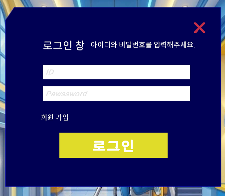 |  |

#### 랭킹 화면에서 기록을 불러오는 방식

팝업을 열 때 `RankingUI`가 `GetTopRankings`를 호출합니다. 조회 도중의 중복 호출을 막고 로딩과 빈 목록을 표시합니다. 응답의 이름과 최고 점수를 슬롯에 배치하고, 현재 유저의 UID와 일치하는 행을 구분해 보여줍니다.

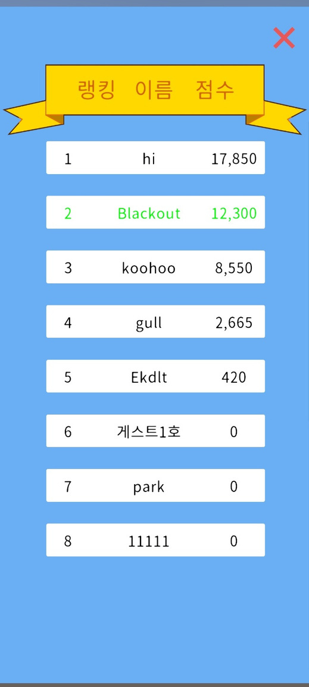

#### JSON과 Firestore의 최고 기록 저장

| 시점 | 처리 방식 |
|---|---|
| 회원가입 | UID로 초기 프로필을 만들어 Firestore에 반영하고 로컬 JSON도 저장합니다. |
| 로그인 이후 | Firestore에서 UID에 해당하는 문서를 요청하고 기기의 JSON도 읽습니다. 양쪽에 기록이 있으면 높은 `bestScore`를 택하고, 동점이면 수정 시각이 더 최근인 데이터를 사용합니다. |
| 조회 실패 | Firestore가 준비되지 않았거나 조회 중 예외가 나면 저장된 로컬 데이터를 읽는 경로를 둡니다. |
| 최고 점수 갱신 | 로비로 돌아가기 버튼이 결과 저장을 호출합니다. 기존 최고 점수를 넘겼을 때 로컬 JSON을 먼저 저장하고 Firestore에도 쓰기를 시도합니다. |

로컬 파일에서 이어 읽는 경로와 서버에 반영하는 경로가 각각 있습니다. 현재 랭킹은 팝업을 열 때 조회한 서버 기록을 표시합니다.

### 3.2 게임 상태와 화면 연결

준비·플레이·결과 화면이 각 게임 상태에 맞게 동작하도록 구현했습니다. Firebase·랭킹을 화면에 연동하고 팀원이 구현한 기능을 합치면서 발생한 오류를 수정했습니다.


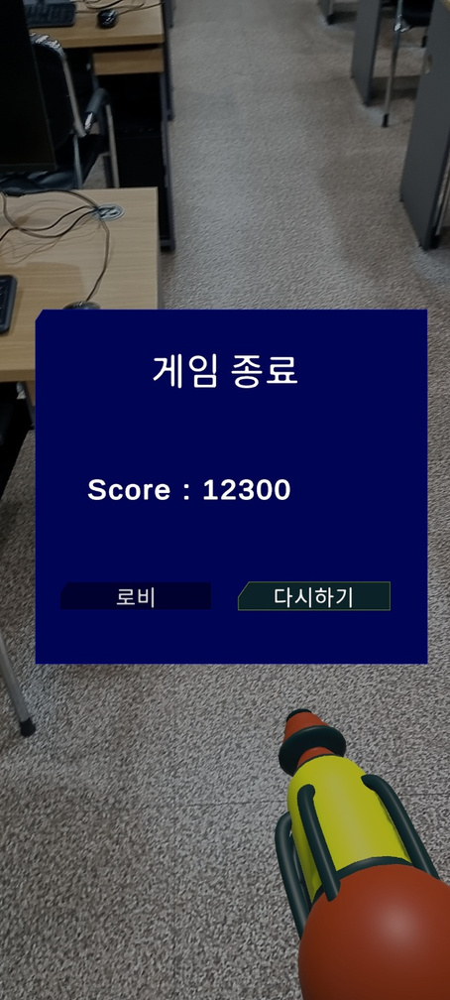

| 상태 | 처리 |
|---|---|
| 초기화 | 입력을 잠그고 물총과 스폰 상태를 초기화합니다. 이전 오염물·평면을 정리한 뒤 스캔을 다시 켜고, 진행률을 UI에 전달합니다. |
| 카운트다운 | 기준 면적을 채우면 스캔 상태를 끝내고 HUD를 켭니다. 대기 시간이 지나면 플레이에 진입합니다. |
| 플레이 | 조작 잠금을 풀고 타이머와 물을 초기화합니다. 물탱크와 난이도별 오염물 배치를 요청하고, 충전 중에는 타이머 차감을 멈춥니다. |
| 결과 | 타이머가 0에 도달하면 입력을 잠그고 생성한 오염물과 물탱크를 정리합니다. 결과 화면에서 다시 하기는 스캔을 초기화하고, 로비 복귀는 최고 기록 저장을 요청합니다. |

HUD는 `GameStatusController`의 물·점수·시간 변경을 구독해 표시를 갱신합니다. 게임 상태는 언제 입력을 받거나 결과를 띄울지를 결정하고, HUD는 받은 상태값을 보여줍니다.

### 3.3 일정·Git·개발 환경 관리

기획·개발 일정을 마일스톤으로 관리하고, 팀의 브랜치 작업과 병합을 맡았습니다. 패키지 버전 불일치와 씬 충돌을 해결하고, 팀이 같은 환경에서 작업하도록 패키지 버전과 도입 기준을 정했습니다.

개발 순서는 콘셉트 확정 → 역할과 마일스톤 정의 → 기능 구현과 테스트 빌드 → 최종 빌드 → 발표 자료와 기술문서 정리로 잡았습니다. 일정표에 기능의 선후 관계와 통합 시점을 적어, 각자 진행한 작업을 테스트 빌드에서 확인할 수 있도록 했습니다.


### 3.4 AR 평면 스캔과 AABB 그룹화

ARScanProvider는 수평 평면의 경계를 월드 좌표로 변환해 AABB를 만들고, 방향이 비슷하고 가까운 평면을 한 그룹으로 묶습니다. 그룹을 감싸는 Bounds를 만든 뒤 XZ 면적을 합산해 스캔 진행률과 완료 기준에 사용합니다. 카메라가 여러 조각으로 감지한 수평면을 플레이에 사용할 수 있는 면적으로 묶었습니다.

```csharp
Bounds combinedBounds = CalculateCombinedBounds(group, planeBoundsMap);
horizontalValue += combinedBounds.size.x * combinedBounds.size.z;
```

#### 면적을 계산하고 플레이를 시작하기까지

1. 트래킹 중인 수평 평면만 골라 경계점마다 `TransformPoint`로 월드 좌표를 구합니다.
2. 각 평면을 감싼 AABB를 만든 뒤, 확장한 AABB의 교차와 법선 내적 조건으로 이웃을 찾습니다. 큐로 이웃을 따라가면서 연결된 평면을 같은 그룹에 넣습니다.
3. 그룹의 AABB를 하나로 감싸 XZ 면적을 더합니다. 목표 면적과의 비율을 0~1로 제한해 진행률을 알리고, 기준을 채우면 상태를 전환합니다.

AABB를 쓰면 경계 계산이 단순하고 여러 평면 조각의 진행률을 한 값으로 볼 수 있습니다. 경계 상자에 포함된 빈 공간도 면적에 들어갈 수 있어, 이 값은 스캔 시작·완료를 판단하는 근사치입니다.

| 스캔 시작 | 진행률 갱신 |
|---|---|
| 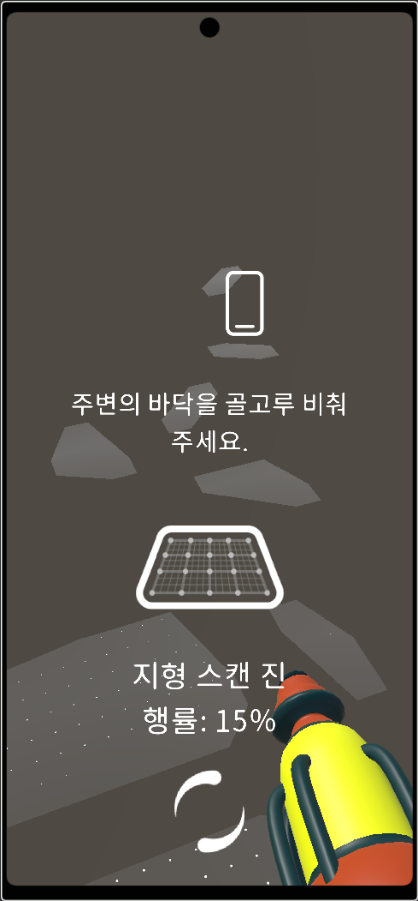 | 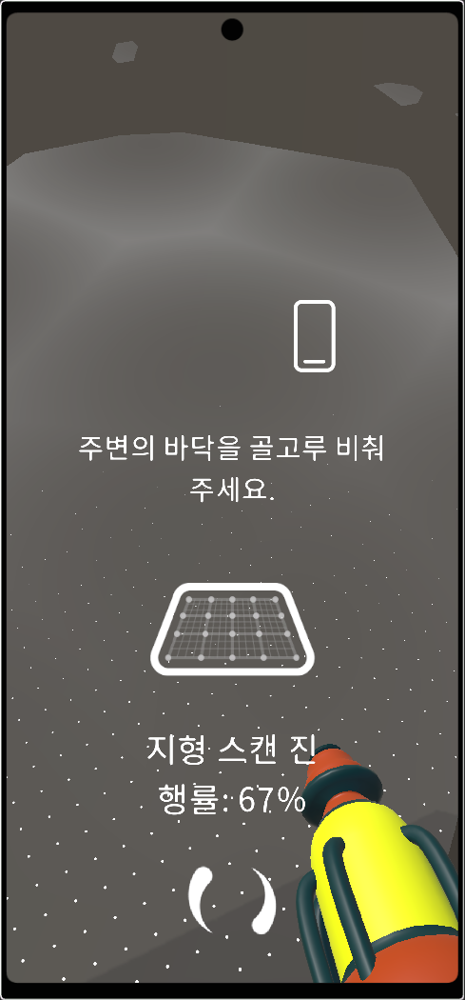 |

| 인식 범위 표시 | 바닥 표면 확인 |
|---|---|
| 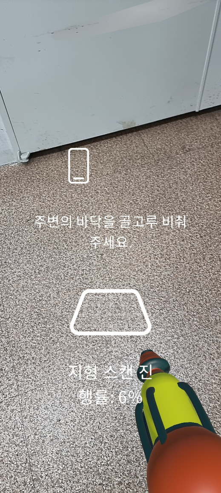 | 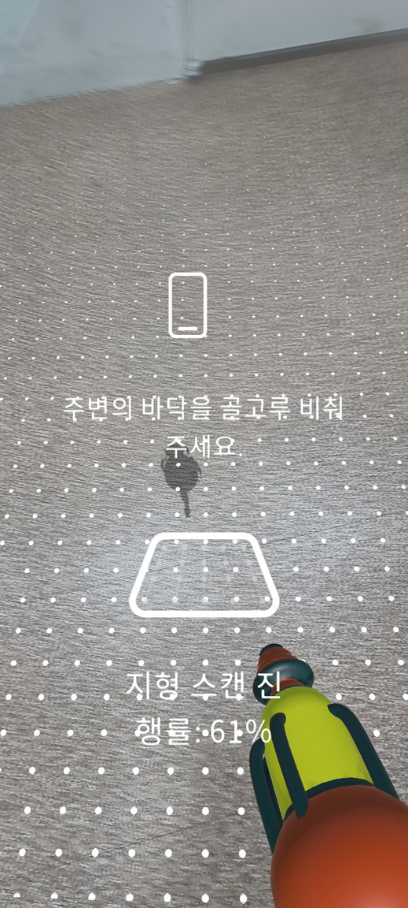 |

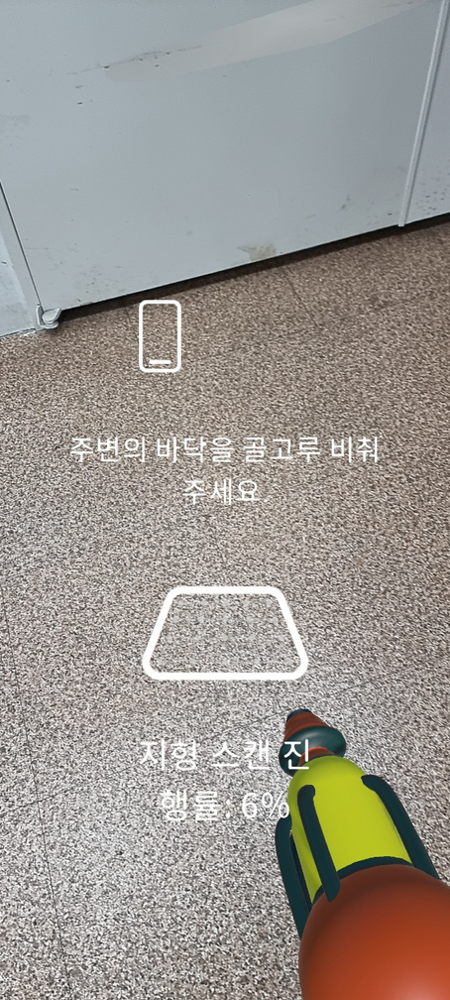

플레이가 시작되면 `ARObjectSpawner`가 난이도별 프리팹, 초기 개수와 생성 간격을 적용합니다. 평면 안에서 배치 후보를 고르고 주변 충돌을 검사하며, 배치한 오염물은 트래킹이 가능한 경우 AR 앵커에 연결합니다.

### 3.5 청소 판정과 오염물 내구도

CleanupHitBox는 대상별 마지막 판정 시간을 기록하고, 설정한 간격이 지나면 세척 이벤트를 보냅니다. 겹쳐 있는 동안 매 프레임 판정하면 콜백 횟수에 따라 세척량이 달라질 수 있어, 세척량을 세척력 × 판정 간격으로 계산했습니다. DustBase는 이를 오염물 내구도에서 빼고, 내구도가 0이 되면 오염물을 제거하고 점수를 반영합니다.

```csharp
if (lastHitTimeDic.TryGetValue(target, out float lastTime) == true)
{
    if (currentTime - lastTime < hitInterval) return;
}
```

레이캐스트로 물줄기의 도착점을 구하거나 트리거로 물줄기에 닿은 콜라이더를 찾습니다. 두 경로는 모두 `CleanupSystem`에 등록된 세척 대상과 같은 시간 제한을 사용합니다. 같은 틱에 두 번 감지되면 마지막 판정 시각으로 중복 적용을 제한합니다.

`DustBase`가 내구도와 제거 점수를 갖고, `CleanupSystem`은 제거 이벤트를 전달합니다. 이 이벤트를 표시·사운드 쪽에서 구독할 수 있어, 물총이 오염 종류별 효과를 직접 제어할 필요가 없습니다.

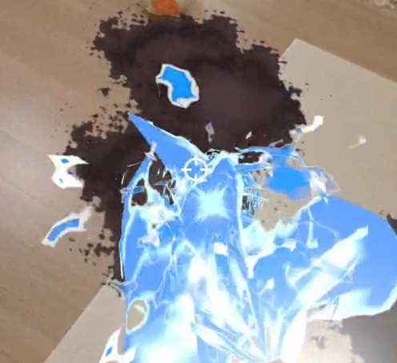

### 3.6 물 자원과 충전

WaterGun은 분사 중 물을 시간에 비례해 소모하고, 잔량이 바닥나면 분사와 세척 판정을 중단합니다. 물탱크 범위 안에서 충전을 시작하면 시간에 따라 물이 차오릅니다. 범위를 벗어나거나 최대치에 도달하면 충전을 끝냅니다. 분사와 충전 상태를 구분해 플레이어가 물을 다 쓰면 충전 지점으로 이동하도록 했습니다.

```csharp
if (currentWaterAmount <= 0)
{
    currentWaterAmount = 0;
    DisableDetection();
    return;
}

currentWaterAmount -= consumptionRate * Time.deltaTime;
```

분사 중에는 초당 소모량에 경과 시간을 곱해 물을 차감합니다. 물이 거의 없고 충전 범위에 있을 때 분사 버튼을 누르면 충전을 시작합니다. `WaterTank`는 범위 안에서 충전 상태일 때만 초당 충전량을 더하고, 물총은 최대치에서 충전을 종료합니다. 범위를 벗어나거나 버튼을 다시 눌러도 충전을 중단합니다.

`WaterTankSystem`은 추적 가능한 상향 수평 평면 중 가장 넓은 것을 골라 중심 근처에 탱크를 배치합니다. 이후 플레이어는 그 지점으로 이동해 물을 보충한 다음 청소를 이어갑니다.

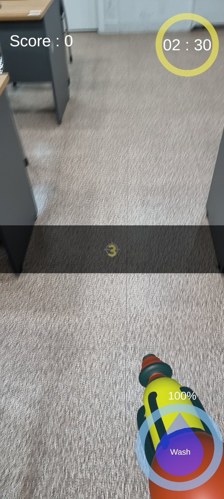

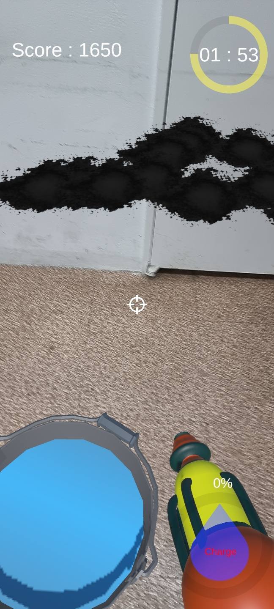

## 4. 협업 문제 해결

### 4.1 XR 패키지 버전 혼재와 컴파일 오류

**문제:** XR Interaction Toolkit과 샘플의 버전이 섞여 StarterAssets 참조 오류가 발생했습니다.

**원인:** manifest.json, packages-lock.json과 샘플 리소스가 서로 다른 버전을 가리키고 있었습니다.

**해결:** 패키지 정의와 잠금 파일, 샘플 리소스를 모두 3.3.0 기준으로 맞췄습니다.

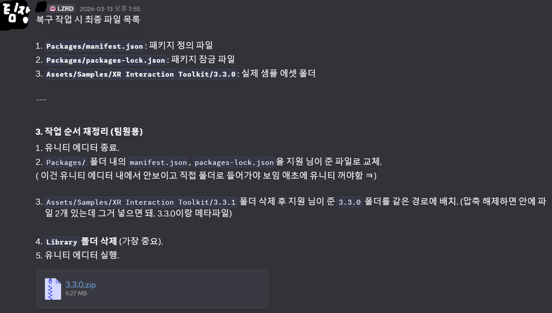

**결과:** 팀 전체가 같은 XR 패키지와 샘플 버전을 사용하도록 정리했습니다.

기술문서에 기록된 3.3.0은 충돌 당시 복구 기준입니다. 현재 Git의 `Packages/manifest.json`은 XR Interaction Toolkit 3.3.1을 가리킵니다.

### 4.2 Git LFS와 병합·씬 충돌 대응

**문제:** Git LFS 할당량이 소진되고 브랜치·씬 충돌까지 발생해 작업 내용을 동기화하거나 합칠 수 없었습니다.

**해결:** LFS 할당량을 확보한 뒤 정상 상태의 develop 브랜치를 기준으로 작업 내용을 다시 맞췄습니다. 충돌한 씬은 정상 시점으로 복원하고 필요한 오브젝트를 다시 배치했습니다.

**결과:** 병합 기준이 되는 브랜치와 씬을 복구했습니다. 이후 씬 분할과 프리팹 단위 작업, 외부 패키지 도입 기준을 정리했습니다.

LFS 동기화 문제에는 할당량을 확보하고 최신 `develop`을 다시 받아 기준을 되찾았습니다. 씬 충돌에서는 정상 시점으로 복원한 뒤 필요한 오브젝트만 다시 반영했습니다. 큰 에셋을 가져오기 전에 공유하고 LFS 사용량을 확인하는 일과, 동시에 바꿀 씬의 범위를 정하는 일을 각각 협업 기준으로 남겼습니다.

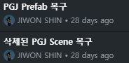

### 4.3 UniTask 중복 설치 정리

**문제:** UniTask 패키지와 직접 가져온 소스가 중복 설치돼 클래스 참조와 컴파일 오류가 발생했습니다.

**해결:** 중복된 소스와 메타 파일을 정리하고 UniTask를 가져오는 경로를 하나로 통일했습니다.

**결과:** UniTask가 한 경로에서만 참조되도록 정리했습니다.

설치 경로와 버전을 외부 라이브러리 도입 전에 팀에서 공유하도록 문서에 적었습니다. 중복 정리 기록은 Git에도 남겼습니다.

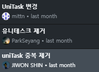

### 4.4 에디터 캐시 손상

**문제:** 패키지 버전과 폴더 구조를 바꾼 뒤 캐시 참조가 깨져 JSON 파싱 오류가 발생하고 Hierarchy 정보가 정상적으로 표시되지 않았습니다.

**해결:** Unity를 종료하고 프로젝트의 Library 폴더를 정리한 뒤 다시 열어 에셋을 재임포트했습니다.

**결과:** 에셋과 패키지를 다시 읽어 캐시를 재구성했습니다. 패키지 파일과 씬을 고치는 일과 에디터의 생성 캐시를 다시 만드는 일을 구분해 대응했습니다.

## 5. 결과

### 5.1 기여 결과

- AR 공간 스캔부터 청소 판정, 물 소모·충전, 결과 화면까지 플레이 흐름을 연결했습니다.
- Firebase 초기화 후 Firestore 최고 기록을 조회해 랭킹 화면에 표시했습니다.
- 팀장·PM으로 일정과 기능 통합을 관리했습니다.
- Git LFS, XR 패키지 버전, UniTask 중복 설치와 씬 충돌 문제를 해결했습니다.

### 5.2 배운 점

카메라 움직임에 따라 평면이 여러 조각으로 들어오는 AR 환경에서는, 모든 조각을 그대로 사용하는 것보다 게임에 필요한 값부터 정하는 게 중요했습니다. 스캔 완료에 필요한 면적, 실제 오염물의 세척 간격, 물의 초당 소모량을 각각 나눠 플레이 흐름에 연결했습니다.

팀 개발에서는 코드가 맞아도 패키지와 샘플이 서로 다른 버전을 가리키거나 같은 씬을 동시에 수정하면 작업이 막힐 수 있다는 것을 배웠습니다. 문제를 복구하는 과정에서 브랜치 병합과 LFS, Unity가 다시 생성하는 캐시의 역할을 구체적으로 이해할 수 있었습니다.

### 5.3 회고

일정과 역할을 나누는 데 익숙하다고 생각했지만, 규칙을 전달한 뒤에도 팀원마다 에셋 설치 방식과 씬 작업 범위를 다르게 이해할 수 있었습니다. 브랜치를 다시 맞추고 필요한 오브젝트를 살리는 과정을 거치며, 각자의 진행 상황과 변경 이유를 함께 확인하는 것이 통합의 일부라는 점을 배웠습니다.

다음 팀 프로젝트에서는 패키지를 추가할 때 설치 경로와 버전을 기록하고, 공용 씬은 프리팹 단위로 나눠 언제 합칠지 먼저 정하고 싶습니다. 실제 기기에서 스캔을 처음 시작하는 경우와 재시작하는 경우, 충전과 결과 저장처럼 상태가 바뀌는 구간도 통합 테스트 항목으로 두고 싶습니다.

### 5.4 코드 근거

| 확인 항목 | Git 소스 |
|---|---|
| 평면 그룹화와 생성 | [ARScanProvider.cs](https://github.com/Searabbit11/-AR-What-happened-in-your-room-/blob/11f7eb8d52ff0ff556f5d44f13f8ddd25502c864/Assets/01.%20Script/PSY/01.Scripts/AR/ARScanProvider.cs) · [ARObjectSpawner.cs](https://github.com/Searabbit11/-AR-What-happened-in-your-room-/blob/11f7eb8d52ff0ff556f5d44f13f8ddd25502c864/Assets/01.%20Script/PSY/01.Scripts/Enemy/ARObjectSpawner.cs) |
| 게임 상태와 결과 저장 | [InGameSystem.cs](https://github.com/Searabbit11/-AR-What-happened-in-your-room-/blob/11f7eb8d52ff0ff556f5d44f13f8ddd25502c864/Assets/01.%20Script/PSY/01.Scripts/System/InGame/InGameSystem.cs) · [PlayState.cs](https://github.com/Searabbit11/-AR-What-happened-in-your-room-/blob/11f7eb8d52ff0ff556f5d44f13f8ddd25502c864/Assets/01.%20Script/PSY/01.Scripts/System/InGame/States/PlayState.cs) · [ResultUI.cs](https://github.com/Searabbit11/-AR-What-happened-in-your-room-/blob/11f7eb8d52ff0ff556f5d44f13f8ddd25502c864/Assets/01.%20Script/PSY/01.Scripts/UI/ResultUI.cs) |
| 청소 판정과 점수 | [CleanupHitBox.cs](https://github.com/Searabbit11/-AR-What-happened-in-your-room-/blob/11f7eb8d52ff0ff556f5d44f13f8ddd25502c864/Assets/01.%20Script/PSY/01.Scripts/System/CleanupHitBox.cs) · [DustBase.cs](https://github.com/Searabbit11/-AR-What-happened-in-your-room-/blob/11f7eb8d52ff0ff556f5d44f13f8ddd25502c864/Assets/01.%20Script/PSY/01.Scripts/Environment/DustBase.cs) |
| 분사와 충전 | [WaterGun.cs](https://github.com/Searabbit11/-AR-What-happened-in-your-room-/blob/11f7eb8d52ff0ff556f5d44f13f8ddd25502c864/Assets/01.%20Script/PSY/01.Scripts/Player/WaterGun.cs) · [WaterTank.cs](https://github.com/Searabbit11/-AR-What-happened-in-your-room-/blob/11f7eb8d52ff0ff556f5d44f13f8ddd25502c864/Assets/01.%20Script/PSY/01.Scripts/InteractiveObject/WaterTank.cs) |
| 인증과 랭킹 | [LoginUI.cs](https://github.com/Searabbit11/-AR-What-happened-in-your-room-/blob/11f7eb8d52ff0ff556f5d44f13f8ddd25502c864/Assets/01.%20Script/PSY/01.Scripts/UI/LoginUI.cs) · [RankingManager.cs](https://github.com/Searabbit11/-AR-What-happened-in-your-room-/blob/11f7eb8d52ff0ff556f5d44f13f8ddd25502c864/Assets/01.%20Script/PSY/01.Scripts/Firebase/RankingManager.cs) · [RankingUI.cs](https://github.com/Searabbit11/-AR-What-happened-in-your-room-/blob/11f7eb8d52ff0ff556f5d44f13f8ddd25502c864/Assets/01.%20Script/PSY/01.Scripts/UI/RankingUI.cs) |
| 로컬·클라우드 기록 | [FirebaseFirestoreManager.cs](https://github.com/Searabbit11/-AR-What-happened-in-your-room-/blob/11f7eb8d52ff0ff556f5d44f13f8ddd25502c864/Assets/01.%20Script/PSY/01.Scripts/Firebase/FirebaseFirestoreManager.cs) · [UserDataSystem.cs](https://github.com/Searabbit11/-AR-What-happened-in-your-room-/blob/11f7eb8d52ff0ff556f5d44f13f8ddd25502c864/Assets/01.%20Script/PSY/01.Scripts/Firebase/UserDataSystem.cs) |
| 현재 XR 패키지 | [manifest.json](https://github.com/Searabbit11/-AR-What-happened-in-your-room-/blob/11f7eb8d52ff0ff556f5d44f13f8ddd25502c864/Packages/manifest.json) |
