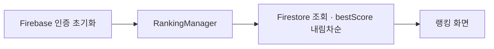
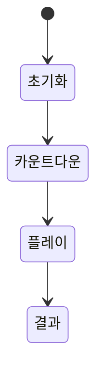

# 방 꼴이 이게 뭐니?!

> 현실 공간의 오염물을 청소하는 4인 팀 AR 게임

| 항목 | 내용 |
|---|---|
| 장르 | AR 캐주얼 청소 슈팅 |
| 개발 기간 | 2026.03 · 2주 |
| 개발 인원 | 4인 팀 프로젝트 |
| 개발 환경 | Unity 6000.3.10f1, C#, Firebase, UniTask |
| 플랫폼 | Android |
| 주요 기술 | AR Foundation 평면 스캔, 상태 기반 게임 흐름, 청소 판정·물 자원, Firebase·Firestore 랭킹, Git 협업 |
| 내 역할 | 팀장·PM, AR 스캔·게임 진행·청소 판정·물 자원, Firebase·랭킹 |
| 링크 | [GitHub](https://github.com/Searabbit11/-AR-What-happened-in-your-room-) · [시연 영상](https://youtu.be/Fu9_N_SvFIg) · [기술 문서 PDF](https://drive.google.com/file/d/1GdKdLITRFBCQQrgyDxzWBgsXXY38_AER/view) |


## 1. 개요

### 1.1 게임과 담당 범위

현실 공간의 오염물을 청소하며 제한 시간 안에 점수를 얻는 AR 게임입니다.

AR 평면을 스캔해 플레이 공간을 만들고, 상태 전환·청소 판정·물 자원을 구현했습니다. Firebase 랭킹을 연동하고 팀장·PM으로 일정과 Git 병합을 관리했습니다.

팀원이 구현한 기능을 프로젝트에 통합하고, 개발 중 막힌 오류를 함께 점검해 해결했습니다.

## 2. 담당 시스템 구조

### 2.1 Firebase와 랭킹 연결

RankingManager는 Firebase 인증 초기화를 기다려 Firestore를 연결합니다. 랭킹 조회 시 bestScore 기준 내림차순으로 요청한 개수만 조회합니다.



### 2.2 준비부터 결과까지의 게임 흐름

플레이 흐름은 준비·진행·결과로 구성했습니다. 코드에서는 준비를 초기화와 카운트다운으로 나누고, InGameSystem이 이전 상태를 종료한 뒤 다음 상태에 진입하도록 했습니다. 각 상태가 화면과 입력을 단계별로 관리해 플레이 중 결과 창이 먼저 뜨는 일을 방지했습니다.

```csharp
currentState?.ExitState();
currentState = stateDictionary[nextType];
currentState.EnterState();
```



## 3. 담당 기능과 프로젝트 운영

### 3.1 Firebase 연결과 랭킹

회원가입·로그인 오류를 안내하고, 랭킹 화면에 이용자별 최고 기록을 표시합니다.


랭킹은 bestScore를 기준으로 조회합니다. 사용자 정보와 플레이 기록은 기기에 JSON으로 저장하고, Firestore에도 반영합니다.

```csharp
Query query = db.Collection(COLLECTION_NAME).OrderByDescending("bestScore").Limit(limit);
QuerySnapshot snapshot = await query.GetSnapshotAsync().AsUniTask();
```

### 3.2 게임 상태와 화면 연결

준비·플레이·결과 화면이 각 게임 상태에 맞게 동작하도록 구현했습니다. Firebase·랭킹을 화면에 연동하고 팀원이 구현한 기능을 합치면서 발생한 오류를 수정했습니다.


### 3.3 일정·Git·개발 환경 관리

기획·개발 일정을 마일스톤으로 관리하고, 팀의 브랜치 작업과 병합을 맡았습니다. 패키지 버전 불일치와 씬 충돌을 해결하고, 팀이 같은 환경에서 작업하도록 패키지 버전과 도입 기준을 정했습니다.


### 3.4 AR 평면 스캔과 AABB 그룹화

ARScanProvider는 수평 평면의 경계를 월드 좌표로 변환해 AABB를 만들고, 방향이 비슷하고 가까운 평면을 한 그룹으로 묶습니다. 그룹을 감싸는 Bounds를 만든 뒤 XZ 면적을 합산해 스캔 진행률과 완료 기준에 사용합니다. 카메라가 여러 조각으로 감지한 수평면을 플레이에 사용할 수 있는 면적으로 묶었습니다.

```csharp
Bounds combinedBounds = CalculateCombinedBounds(group, planeBoundsMap);
horizontalValue += combinedBounds.size.x * combinedBounds.size.z;
```

### 3.5 청소 판정과 오염물 내구도

CleanupHitBox는 대상별 마지막 판정 시간을 기록하고, 설정한 간격이 지나면 세척 이벤트를 보냅니다. 겹쳐 있는 동안 매 프레임 판정하면 콜백 횟수에 따라 세척량이 달라질 수 있어, 세척량을 세척력 × 판정 간격으로 계산했습니다. DustBase는 이를 오염물 내구도에서 빼고, 내구도가 0이 되면 오염물을 제거하고 점수를 반영합니다.

```csharp
if (lastHitTimeDic.TryGetValue(target, out float lastTime) == true)
{
    if (currentTime - lastTime < hitInterval) return;
}
```

### 3.6 물 자원과 충전

WaterGun은 분사 중 물을 시간에 비례해 소모하고, 잔량이 바닥나면 분사와 세척 판정을 중단합니다. 물탱크 범위 안에서 충전을 시작하면 시간에 따라 물이 차오릅니다. 범위를 벗어나거나 최대치에 도달하면 충전을 끝냅니다. 분사와 충전 상태를 구분해 플레이어가 물을 다 쓰면 충전 지점으로 이동하도록 했습니다.

```csharp
if (currentWaterAmount <= 0)
{
    currentWaterAmount = 0;
    DisableDetection();
    return;
}

currentWaterAmount -= consumptionRate * Time.deltaTime;
```

## 4. 협업 문제 해결

### 4.1 XR 패키지 버전 혼재와 컴파일 오류

**문제:** XR Interaction Toolkit과 샘플의 버전이 섞여 StarterAssets 참조 오류가 발생했습니다.

**원인:** manifest.json, packages-lock.json과 샘플 리소스가 서로 다른 버전을 가리키고 있었습니다.

**해결:** 패키지 정의와 잠금 파일, 샘플 리소스를 모두 3.3.0 기준으로 맞췄습니다.


**결과:** 팀 전체가 같은 XR 패키지와 샘플 버전을 사용하도록 정리했습니다.

### 4.2 Git LFS와 병합·씬 충돌 대응

**문제:** Git LFS 할당량이 소진되고 브랜치·씬 충돌까지 발생해 작업 내용을 동기화하거나 합칠 수 없었습니다.

**해결:** LFS 할당량을 확보한 뒤 정상 상태의 develop 브랜치를 기준으로 작업 내용을 다시 맞췄습니다. 충돌한 씬은 정상 시점으로 복원하고 필요한 오브젝트를 다시 배치했습니다.

**결과:** 병합 기준이 되는 브랜치와 씬을 복구했습니다. 이후 씬 분할과 프리팹 단위 작업, 외부 패키지 도입 기준을 정리했습니다.

### 4.3 UniTask 중복 설치 정리

**문제:** UniTask 패키지와 직접 가져온 소스가 중복 설치돼 클래스 참조와 컴파일 오류가 발생했습니다.

**해결:** 중복된 소스와 메타 파일을 정리하고 UniTask를 가져오는 경로를 하나로 통일했습니다.

**결과:** UniTask가 한 경로에서만 참조되도록 정리했습니다.

### 4.4 에디터 캐시 손상

**문제:** 패키지 버전과 폴더 구조를 바꾼 뒤 캐시 참조가 깨져 JSON 파싱 오류가 발생하고 Hierarchy 정보가 정상적으로 표시되지 않았습니다.

**해결:** Unity를 종료하고 프로젝트의 Library 폴더를 정리한 뒤 다시 열어 에셋을 재임포트했습니다.

## 5. 결과

### 5.1 기여 결과

- AR 공간 스캔부터 청소 판정, 물 소모·충전, 결과 화면까지 플레이 흐름을 연결했습니다.
- Firebase 초기화 후 Firestore 최고 기록을 조회해 랭킹 화면에 표시했습니다.
- 팀장·PM으로 일정과 기능 통합을 관리했습니다.
- Git LFS, XR 패키지 버전, UniTask 중복 설치와 씬 충돌 문제를 해결했습니다.
